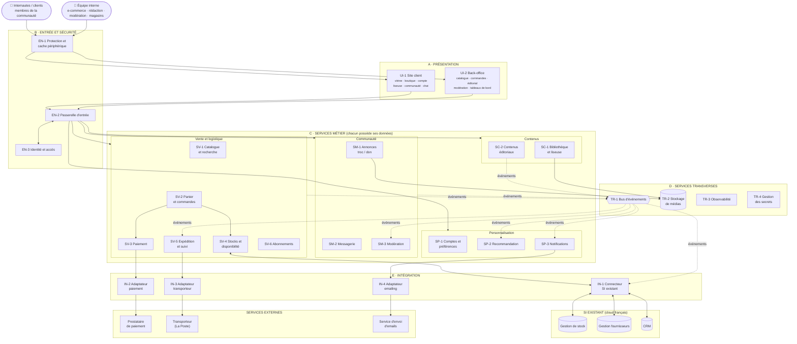
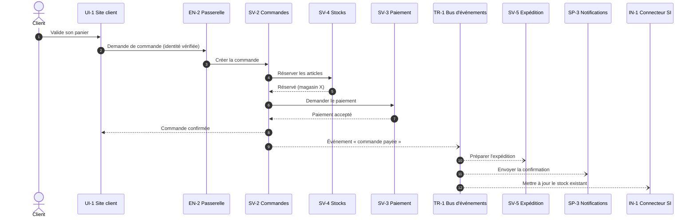
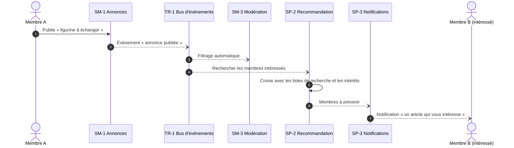

# US-03.2 — Architecture macroscopique

> **Jira :** [SCRUM-21](https://maalsi25.atlassian.net/browse/SCRUM-21) · **Epic :** EPIC 03, Architecture macroscopique
> **Responsable :** Membre A · **Binôme :** Membre C
> **Entrée :** [US-03.1, composants fonctionnels](US-03.1_composants_fonctionnels.md) (identifiants UI-x, EN-x, SV-x, SC-x, SM-x, SP-x, TR-x, IN-x)

**But :** fournir à la direction un **schéma lisible** des composants de `petitemaisonepouvante.com` et de leurs échanges, **indépendant des technologies**.

> ⚠️ Conformément à la consigne, le schéma ne nomme **aucun framework, moteur de base de données ni protocole**. Il distingue seulement les échanges **synchrones** (demande / réponse immédiate) et **asynchrones** (événements).

---

## 1. Schéma d'architecture macroscopique

> Schéma original réalisé par le groupe. Le source Mermaid ci-dessous sert de référence et est redessiné dans le support PPT.

### Légende

| Symbole | Signification |
|---|---|
| **Flèche pleine** `──►` | Échange **synchrone** : l'appelant attend une réponse immédiate (afficher un produit, payer) |
| **Flèche en pointillé** `- - ►` | Échange **asynchrone** par événement : l'émetteur publie un fait (« commande payée ») sans attendre. Les composants intéressés réagissent |
| **Cadre « C · Services métier »** | Chaque service possède **ses propres données**, inaccessibles directement par les autres |
| Les flux vers **TR-3 Observabilité** et **TR-4 Secrets** ne sont pas dessinés | Tous les composants les utilisent. Ils sont omis pour la lisibilité |

---

## 2. Responsabilités des composants (résumé pour la soutenance)

| Bloc | Composant | Responsabilité en une phrase |
|---|---|---|
| **Présentation** | UI-1 Site client | Toute l'expérience client, publique et authentifiée, accessible (RGAA) |
| | UI-2 Back-office | Outil de travail des équipes internes |
| **Entrée** | EN-1 Protection et cache | Filtrer les attaques et accélérer les contenus publics |
| | EN-2 Passerelle | Point d'entrée unique : router, contrôler l'identité, limiter le débit |
| | EN-3 Identité et accès | Savoir **qui** est l'utilisateur et **ce qu'il a le droit** de faire |
| **Vente** | SV-1 Catalogue et recherche | Présenter et retrouver les produits |
| | SV-2 Panier et commandes | Transformer un panier en commande suivie de bout en bout |
| | SV-3 Paiement | Encaisser et rembourser, **sans stocker de carte** |
| | SV-4 Stocks et disponibilité | Dire ce qui est réellement disponible dans les 4 magasins et le réserver |
| | SV-5 Expédition et suivi | Expédier et suivre les colis |
| | SV-6 Abonnements | Gérer les abonnements au fanzine et leur renouvellement |
| **Contenus** | SC-1 Bibliothèque et liseuse | Donner accès aux numéros achetés, de façon protégée |
| | SC-2 Contenus éditoriaux | Publier news et articles pour tous |
| **Communauté** | SM-1 Annonces troc et don | Proposer, rechercher et échanger des objets entre membres |
| | SM-2 Messagerie | Discuter en temps réel entre passionnés |
| | SM-3 Modération | Garder l'espace communautaire sain et légal |
| **Personnalisation** | SP-1 Comptes et préférences | Profil, intérêts, réglages |
| | SP-2 Recommandation | Proposer les bons produits et détecter les annonces intéressantes |
| | SP-3 Notifications | Prévenir l'utilisateur, sur le bon canal, sans le saturer |
| **Transverse** | TR-1 Bus d'événements | Faire circuler les faits métier sans couplage entre composants |
| | TR-2 Stockage de médias | Stocker images et fichiers, avec accès protégé si besoin |
| | TR-3 Observabilité | Voir ce qui se passe et alerter |
| | TR-4 Secrets | Protéger clés et mots de passe |
| **Intégration** | IN-1 Connecteur SI | Faire dialoguer la plateforme avec le stock, les fournisseurs et le CRM existants |
| | IN-2/3/4 Adaptateurs | Isoler la plateforme des prestataires externes (paiement, transport, email) |

---

## 3. Deux scénarios pour illustrer les échanges

### 3.1 Achat d'un produit physique

**Points clés :** la réservation du stock et le paiement sont **synchrones**, car le client doit savoir immédiatement si sa commande est acceptée. Tout le reste est **asynchrone** : une lenteur de l'emailing ou du SI existant **ne retarde pas** la confirmation.

### 3.2 Nouvelle annonce de troc et notification des membres intéressés

---

## 4. Prise en compte des exigences non fonctionnelles

| Exigence (US-02.1) | Réponse architecturale |
|---|---|
| **Sécurité** | **Défense en profondeur** : EN-1 (filtrage), EN-2 (contrôle à l'entrée), EN-3 (identité centralisée, MFA, rôles), chaque service revérifie les droits. Données sensibles cloisonnées par service. **Aucune donnée de carte** stockée (SV-3 délègue au prestataire). Secrets dans TR-4. Échanges internes chiffrés. Journaux de sécurité vers TR-3 |
| **Disponibilité / fiabilité** | Chaque composant est **redondé** (au moins 2 instances). **Isolation des pannes** : recommandation, chat ou notifications en panne, l'achat continue. Le bus d'événements **conserve les messages** si un consommateur est indisponible (pas de perte). Sauvegardes de chaque base de données |
| **Performance** | Cache des contenus publics en EN-1. Moteur de recherche dédié dans SV-1. Traitements lourds (recommandations, notifications, synchronisation SI) **en asynchrone**, hors du parcours utilisateur |
| **Scalabilité** | Services **sans état**, dupliqués à la demande. Les composants les plus sollicités lors des pics (SV-1, SV-2, SV-4, EN-1) se mettent à l'échelle **indépendamment** des autres |
| **Accessibilité** | Concentrée dans UI-1 et UI-2 avec un design system unique conforme RGAA. Les contenus du fanzine dans SC-1 doivent être fournis dans un format accessible |
| **Maintenabilité** | Un composant = un domaine, avec une interface documentée. Adaptateurs IN-x : on change de prestataire sans toucher au métier. Ajout des services V2/V3 **sans refonte** |
| **Interopérabilité** | IN-1 centralise les échanges avec le SI existant et **remplace les CSV manuels**. Interfaces documentées et versionnées |
| **Hébergement en Europe / RGPD** | Tous les composants et toutes les données sont hébergés dans l'UE. Les données de profilage (SP-2) sont isolées, soumises au consentement géré par EN-3 et SP-1, et ont une durée de conservation limitée |

### Zones de sécurité logiques

| Zone | Composants | Exposition |
|---|---|---|
| **Zone publique** | EN-1, UI-1, UI-2 (UI-2 avec accès restreint) | Internet |
| **Zone applicative** | EN-2, EN-3, services métier, TR-1 | Accessible **uniquement** par la passerelle |
| **Zone données** | Bases des services, TR-2, entrepôt analytique | Accessible **uniquement** par le service propriétaire |
| **Zone intégration** | IN-1 à IN-4 | Flux sortants maîtrisés vers le SI existant et les prestataires |
