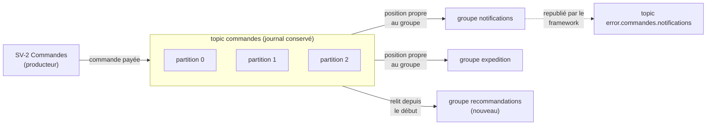

# Démonstration de la seconde technologie : Apache Kafka

> **Story :** US-05.3 · **Jira :** [SCRUM-29](https://maalsi25.atlassian.net/browse/SCRUM-29) · **Epic :** EPIC 05, Comparaison et démonstration de deux technologies applicatives
> **Responsable :** Membre A *(renfort)* · **Binôme :** Membre C
> **Scénario de référence :** [US-05.1](domaine-et-criteres.md) §4 · **Application :** [boutique de démonstration](../../README.md) · **Scénario :** [`tools/scenarios/bus.py`](../../tools/scenarios/bus.py) · **Banc de débit :** [`tools/scenarios/banc-brokers/`](../../tools/scenarios/banc-brokers/)

---

## 1. Cas d'usage démontré

**Strictement le même** que pour RabbitMQ ([US-05.2](demo-rabbitmq.md)) : l'événement « commande payée » de la boutique, publié par Commandes et consommé par Notifications et Expédition. Les services et le scénario sont **identiques** : on bascule simplement le broker (`npm run boutique -- bus kafka`, environ 30 s, sans reconstruire d'image).

## 2. Topologie mise en place

| Concept Kafka | Rôle dans la démo |
|---|---|
| **Topic** | Journal **en ajout seul** : les événements y restent pendant la durée de rétention (7 jours par défaut), qu'ils aient été lus ou non |
| **Partitions (3)** | Unité de parallélisme. Une **clé** de message (par exemple le membre) garantit que les événements d'un même client restent **dans l'ordre** |
| **Groupe de consommateurs** | Un groupe par service. Chaque groupe mémorise **sa position** (*offset*) dans le journal |
| **Commit de position** | Le service enregistre sa position après traitement. En cas de panne, il reprend là où il s'était arrêté |
| **`acks=all` + idempotence** | L'écriture est confirmée et un nouvel essai ne crée pas de doublon |
| **Mode KRaft** | Kafka gère lui-même ses métadonnées (sans ZooKeeper depuis la version 3.3) |
| **DLQ** | **N'existe pas dans le broker.** Le **framework** (binder Kafka de Spring Cloud Stream, `enable-dlq: true`) republie le message invalide dans un topic dédié. Sans ce framework, ce serait à coder dans chaque service |

## 3. Déroulé de la démonstration (environ 3 min)

| # | Action | Ce que la direction voit |
|---|---|---|
| 1 | `npm run boutique -- bus kafka` (lancé avant la soutenance) | Même boutique, autre broker : l'en-tête du site affiche « Kafka » |
| 2 | Ouvrir kafka-ui http://localhost:8081 | Topics, partitions, messages, groupes et leurs positions |
| 3 | `npm run scenario:bus` | Les mêmes étapes, les mêmes vérifications |
| 4 | Étape 2, onglet *Consumers* | Le groupe `expedition` a un **retard** (*lag*) de 5, qui retombe à 0 au redémarrage |
| 5 | Étape 3 | Le nouveau groupe `recommandations` **relit toutes les commandes passées** : c'est la différence clé avec RabbitMQ |
| 6 | Onglet *Topics → Messages* | Les messages sont **toujours là** après lecture |

## 4. Résultats observés

**Scénario sur la boutique** (même poste, même jour que US-05.2) :

| Étape | Résultat | Attendu | Statut |
|---|---|---|---|
| 1. Diffusion (notifications / expédition) | 5 / 5 | 5 / 5 | OK |
| 2. Panne : notifications en ligne / expédition rattrapée | 5 / 5 | 5 / 5 | OK |
| 3. Rejeu de l'historique par un nouveau service | **10** (tout le journal, depuis le démarrage du broker) | ≥ 10 | (force du modèle) |
| 4. Poison : traité / isolé en DLQ | 0 / 1 | 0 / 1 | (DLQ fournie par le framework) |
| **Bilan** | **7 / 7 vérifications**, 51 s (dont le redémarrage du service expédition) | | OK |

**Mesures dans la boutique** (`tools/scenarios/mesures.py`, 40 commandes) : délai entre la commande et la notification reçue dans le navigateur **30 ms en médiane, 50 ms au 95e centile**. Mémoire du broker **328 Mio** (charge de la boutique), image de **199 Mio**.

> **Incident rencontré :** au premier envoi vers Kafka (création du topic), la réponse a dépassé 1 s. Le coupe-circuit de la passerelle a alors renvoyé « indisponible » alors que la commande était enregistrée, d'où un risque de double commande. Le délai a été porté à 5 s (voir [US-05.5](../passerelle-api/spring-cloud-gateway-ou-kong.md)).

**Banc de débit brut** (mêmes conditions que RabbitMQ, 14/11/2026) :

| Mode | Publication | Consommation |
|---|---|---|
| `acks=all`, envoi par lots | **21 900 à 22 500 msg/s** | **216 000 à 270 000 msg/s** |

**Empreinte (banc brut, après le passage de 20 000 messages) :** **995 Mio** de mémoire pour le broker seul (+ 386 Mio pour la console kafka-ui), démarrage à froid en **~8 s**.

## 5. Prérequis et limites rencontrés

| Constat | Détail |
|---|---|
| **Rejeu natif** | N'importe quel nouveau service peut relire l'historique, sans rien demander au producteur |
| **Débit très élevé** | Publication environ **2 fois** plus rapide, consommation environ **14 fois** plus rapide que RabbitMQ (lecture séquentielle par lots) |
| **Ordre garanti par clé** | Tous les événements d'un même client arrivent dans l'ordre : utile pour les enchères de la V2 |
| **Configuration plus lourde** | **13 variables** de configuration pour un seul nœud (écoutes réseau, contrôleur KRaft, facteurs de réplication) contre 2 pour RabbitMQ |
| **Concepts plus nombreux** | Partitions, groupes, positions, rééquilibrage, rétention : courbe d'apprentissage plus raide pour des alternants |
| **Rééquilibrage** | À la première lecture, un groupe attend l'attribution de ses partitions (quelques secondes). Le code doit le gérer (cas rencontré pendant la démo) |
| **Commit de position** | Un commit message par message limitait la consommation à **4 000 msg/s**. Il faut le faire **par lot** (problème rencontré et corrigé) |
| **Pas de DLQ dans le broker** | Le rebut et les nouvelles tentatives sont fournis par le **framework** (Spring Cloud Stream). Ils dépendent donc du langage et de la bibliothèque de chaque service. Le routage fin reste à coder (ou à confier à Kafka Streams) |
| **Empreinte mémoire** | **2,2 fois** celle de RabbitMQ dans la boutique (328 contre 147 Mio), **6 fois** sous la charge du banc brut. En production, **3 nœuds minimum** sont recommandés pour la tolérance aux pannes |
| **Pas de console intégrée** | La console est un produit tiers à déployer et à sécuriser |

---

[← Démonstration de la première technologie : RabbitMQ](demo-rabbitmq.md) · [Sommaire](../README.md) · [Argumentation du choix technique : bus d'événements →](comparaison-et-choix.md)
