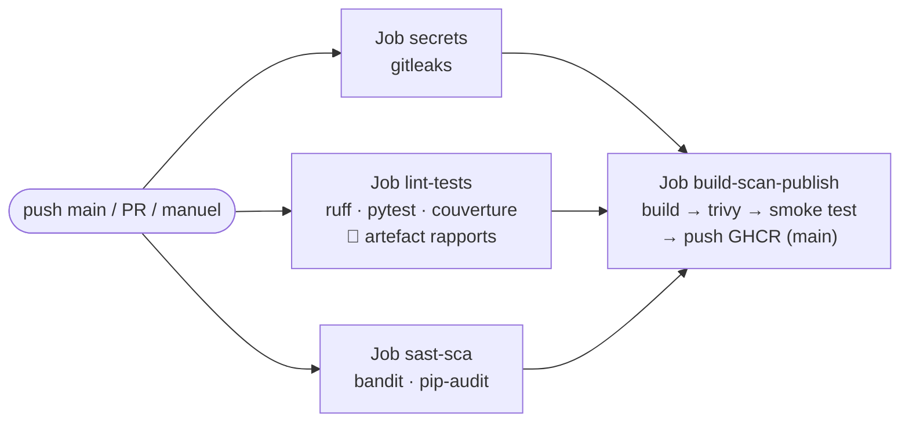

# US-04.2 — Démonstration du premier outil : GitHub Actions

> **Jira :** [SCRUM-24](https://maalsi25.atlassian.net/browse/SCRUM-24) · **Epic :** EPIC 04, Comparaison et démonstration de deux solutions CI/CD
> **Responsable :** Membre B · **Binôme :** Membre D
> **Scénario de référence :** [US-04.1](US-04.1_candidats_et_criteres.md) · **Code :** [`demos/cicd/`](../../demos/cicd/) · **Pipeline :** [`.github/workflows/ci.yml`](../../demos/cicd/.github/workflows/ci.yml)

---

## 1. Contenu de la démo

| Élément | Fichier |
|---|---|
| Mini-service catalogue (support identique aux deux outils) | `demos/cicd/app/`, `tests/`, `Dockerfile` |
| Pipeline GitHub Actions | `demos/cicd/.github/workflows/ci.yml` |
| Smoke test commun | `demos/cicd/ci/smoke-test.sh` |
| Scénarios d'échec | `demos/cicd/demo/scenario.sh` |
| Procédure complète | [`demos/cicd/README.md`](../../demos/cicd/README.md) |

La démo est **reproductible** et **ne nécessite pas l'e-commerce** : il suffit de pousser `demos/cicd/` dans un dépôt GitHub (README, sections 0 et 1).

---

## 2. Structure du pipeline

| Concept GitHub Actions | Utilisation dans la démo |
|---|---|
| **Workflow** (`on:`) | Déclenché par `push` sur `main`, `pull_request` et `workflow_dispatch` (bouton manuel) |
| **Jobs** | 4 jobs. Les 3 premiers tournent **en parallèle** sur des runners distincts |
| **`needs:`** | Le build n'est lancé que si les 3 jobs de qualité sont verts : c'est la **quality gate** |
| **Actions du marketplace** | `actions/checkout`, `actions/setup-python` (avec **cache pip**), `actions/upload-artifact`, `docker/login-action` |
| **`permissions:`** | Lecture seule par défaut. `packages: write` est accordé **uniquement** au job de publication (moindre privilège) |
| **`secrets.GITHUB_TOKEN`** | Jeton éphémère généré par GitHub pour publier sur GHCR. **Aucun secret à créer** |
| **`$GITHUB_STEP_SUMMARY`** | Résumé des tests et de l'image publiée affiché sur la page du run |
| **`if:`** | La publication n'a lieu que sur un `push` vers `main`, jamais sur une PR |

---

## 3. Déroulé de la démonstration (environ 3 min)

| # | Action | Ce que la direction voit |
|---|---|---|
| 1 | Montrer `ci.yml` dans le dépôt | Le pipeline est **du code**, versionné et relu comme le reste |
| 2 | Pousser un commit sur `main` (ou *Run workflow*) | **Déclenchement** immédiat dans l'onglet *Actions* |
| 3 | Ouvrir le run | Graphe des **jobs parallèles** puis du job de build, avec le statut en temps réel |
| 4 | Ouvrir un job | **Logs** de chaque étape, durée, résumé des tests |
| 5 | Montrer *Packages* | **Résultat** : l'image versionnée est publiée dans GHCR |
| 6 | `sh demo/scenario.sh regression` → commit → push | Le job **lint-tests** passe au rouge et le **build n'est pas lancé** |
| 7 | Ouvrir une PR avec la régression | Le **statut ✗ s'affiche directement sur la PR** : on ne peut pas fusionner en confiance |

---

## 4. Vérifications effectuées

| Vérification | Résultat |
|---|---|
| Syntaxe et expressions du workflow (`actionlint` 1.7.7) | ✅ Aucune erreur |
| Lint (ruff) | ✅ Aucune erreur |
| Tests unitaires + couverture | ✅ 8/8 tests, couverture 100 % (seuil 80 %) |
| SAST (bandit, sévérité haute) | ✅ Aucune alerte |
| SCA (pip-audit) | ✅ Aucune dépendance vulnérable |
| Secrets (gitleaks) | ✅ Aucun secret |
| Build de l'image + scan trivy (critique) | ✅ Aucune vulnérabilité critique corrigeable |
| Smoke test (`/health`, `/api/produits/1`) | ✅ OK |
| Scénarios `regression` et `secret` (mêmes commandes, exécutées via Jenkins, builds #2 et #3) | ✅ Livraison bloquée, comme attendu |

> Ces étapes ont été exécutées **en local avec les mêmes commandes et les mêmes images** que le workflow. L'exécution **sur les runners GitHub** reste à faire par Membre B lors du premier push (les mesures sont à reporter en section 5).

---

## 5. Mesures à relever lors de l'exécution sur GitHub

| Mesure | Valeur |
|---|---|
| Temps de mise en place (de la création du dépôt au premier run vert) | *à relever* (estimation : 15 à 30 min) |
| Durée du premier run | *à relever* |
| Durée d'un run suivant (cache pip actif) | *à relever* |
| Délai entre push et démarrage du run | *à relever* (généralement quelques secondes) |
| Scénario `regression` : temps jusqu'au signal rouge | *à relever* |
| Scénario `secret` : comportement | *à relever* (la *push protection* de GitHub peut bloquer le push avant le pipeline) |

---

## 6. Observations (forces et points de friction)

**Points forts constatés :**
- **Aucune infrastructure à installer** : le pipeline existe dès que le fichier YAML est poussé.
- **Intégration native au dépôt** : statut sur les PR, lien direct commit ↔ run, registre GHCR intégré, jeton éphémère.
- **Parallélisme naturel** : chaque job tourne sur un runner neuf (isolation forte, pas d'état résiduel).
- **Marketplace** : setup de Python, cache et artefacts en une ligne chacun.
- **Moindre privilège** simple à exprimer (`permissions:` par job).

**Points de friction :**
- **Pas d'exécution locale native** : pour tester le workflow avant de le pousser, il faut des outils tiers ou multiplier les commits « fix CI ».
- **Runners hébergés aux États-Unis** par défaut (Azure) : le code, les logs et les artefacts transitent hors UE. Les runners **auto-hébergés en Europe** sont possibles, mais réintroduisent de la maintenance.
- **Actions tierces = risque de chaîne d'approvisionnement** : une action compromise exécute du code dans le pipeline. Bonne pratique : figer les actions par **SHA de commit** plutôt que par tag (`@v4`).
- **Quotas** de minutes gratuites sur les dépôts privés (2 000 min par mois en offre gratuite), au-delà facturé à la minute.
- **Dépendance forte à GitHub** (forge, CI, registre) : migrer vers une autre forge plus tard est coûteux.
