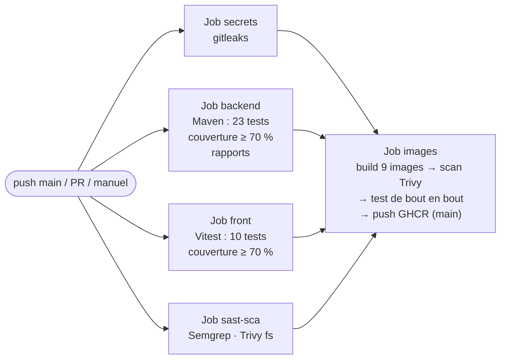

# US-04.2 — Démonstration du premier outil : GitHub Actions

> **Jira :** [SCRUM-24](https://maalsi25.atlassian.net/browse/SCRUM-24) · **Epic :** EPIC 04, Comparaison et démonstration de deux solutions CI/CD
> **Responsable :** Membre B · **Binôme :** Membre D
> **Scénario de référence :** [US-04.1](US-04.1_candidats_et_criteres.md) · **Application :** [boutique de démonstration](../../README.md) · **Pipeline :** [`.github/workflows/boutique.yml`](../../.github/workflows/boutique.yml)

---

## 1. Contenu de la démo

| Élément | Fichier |
|---|---|
| Application livrée : **boutique front + microservices** (support identique aux deux outils) | `apps/front/`, `apps/back/`, `infra/kong/`, `infra/postgres/` |
| Pipeline GitHub Actions | `.github/workflows/ci.yml` |
| Étapes communes aux deux outils | `infra/ci/scan-images.sh` (scan des images), `infra/ci/smoke-test.sh` + `infra/ci/smoke.py` (test de bout en bout) |
| Registre des vulnérabilités acceptées | `.trivyignore.yaml` |
| Scénarios d'échec | `tools/demo/scenario.sh` |
| Procédure complète | [`README.md` de la boutique](../../README.md), section 4 |

La boutique est poussée dans **son propre dépôt GitHub** (README, section 4). Le pipeline livre la **vraie application de démonstration** : 9 images (front, passerelle, 5 services Spring Boot, Kong, PostgreSQL).

---

## 2. Structure du pipeline

| Concept GitHub Actions | Utilisation dans la démo |
|---|---|
| **Workflow** (`on:`) | Déclenché par `push` sur `main`, `pull_request` et `workflow_dispatch` (bouton manuel) |
| **Jobs** | 5 jobs. Les 4 premiers tournent **en parallèle** sur des runners distincts |
| **`needs:`** | Les images ne sont construites que si les 4 jobs de qualité sont verts : c'est la **quality gate** |
| **Actions du marketplace** | `actions/checkout`, `actions/setup-java` et `actions/setup-node` (avec **cache Maven et npm**), `actions/upload-artifact`, `docker/login-action` |
| **`permissions:`** | Lecture seule par défaut. `packages: write` est accordé **uniquement** au job de publication (moindre privilège) |
| **`secrets.GITHUB_TOKEN`** | Jeton éphémère généré par GitHub pour publier sur GHCR. **Aucun secret à créer** |
| **`$GITHUB_STEP_SUMMARY`** | Résumé des tests et des images publiées affiché sur la page du run |
| **`if:`** | La publication n'a lieu que sur un `push` vers `main`, jamais sur une PR |

---

## 3. Déroulé de la démonstration (environ 3 min)

| # | Action | Ce que la direction voit |
|---|---|---|
| 1 | Montrer `ci.yml` dans le dépôt | Le pipeline est **du code**, versionné et relu comme le reste |
| 2 | Pousser un commit sur `main` (ou *Run workflow*) | **Déclenchement** immédiat dans l'onglet *Actions* |
| 3 | Ouvrir le run | Graphe des **4 jobs parallèles** puis du job images, avec le statut en temps réel |
| 4 | Ouvrir le job images, étape « test de bout en bout » | La **boutique complète** démarre dans le runner : connexion, commande, notification reçue par le bus |
| 5 | Montrer *Packages* | **Résultat** : les 9 images versionnées sont publiées dans GHCR |
| 6 | `sh tools/demo/scenario.sh regression` → commit → push | Le job **backend** passe au rouge et les **images ne sont pas construites** |
| 7 | Ouvrir une PR avec la régression | Le **statut rouge s'affiche directement sur la PR** : on ne peut pas fusionner en confiance |

---

## 4. Vérifications effectuées

| Vérification | Résultat |
|---|---|
| Syntaxe et expressions du workflow (`actionlint` 1.7.7, avec shellcheck) | Aucune erreur |
| Backend : tests et couverture (Maven, Spring Boot 4.0) | 23/23 tests, seuil de 70 % de couverture respecté pour chaque service (notifications : 86 %) |
| Front : tests et couverture (Vitest) | 10/10 tests, couverture 80 % (seuil 70 %) |
| SAST (Semgrep, règles Java, React et secrets, sévérité ERROR) | Aucune alerte |
| SCA (Trivy, dépendances Maven et npm) | Aucune vulnérabilité critique corrigeable |
| Secrets (gitleaks) | Aucun secret |
| Build des 9 images + scan Trivy (critique) | Après migration vers Spring Boot 4.0 et une exception documentée (voir encadré) |
| Test de bout en bout (boutique complète, 9 vérifications) | OK en 44 s |
| Scénarios `regression` et `secret` (mêmes commandes, exécutées via Jenkins) | Livraison bloquée, comme attendu |

> **Incident utile pour la démonstration :** au premier passage, le **scan des images a bloqué la livraison**. Spring Boot 3.4 embarquait des failles critiques (Tomcat, Spring Framework, Spring Security) corrigées seulement dans Spring Framework 7. Le pipeline a donc imposé la **migration vers Spring Boot 4.0.10**. Une faille non exploitable de l'image PostgreSQL (`gosu`) est acceptée, avec justification et date d'expiration, dans `.trivyignore.yaml` (voir [US-07.4](../securite/US-07.4_amelioration_continue.md)).
>
> Ces étapes ont été exécutées **en local et dans Jenkins avec les mêmes commandes et les mêmes images** que le workflow. L'exécution **sur les runners GitHub** reste à faire par Membre B lors du premier push (les mesures sont à reporter en section 5).

---

## 5. Mesures à relever lors de l'exécution sur GitHub

| Mesure | Valeur |
|---|---|
| Temps de mise en place (de la création du dépôt au premier run vert) | *à relever* (estimation : 15 à 30 min) |
| Durée du premier run | *à relever* |
| Durée d'un run suivant (cache Maven et npm actif) | *à relever* (référence Jenkins local : 3 min 24 s) |
| Délai entre push et démarrage du run | *à relever* (généralement quelques secondes) |
| Scénario `regression` : temps jusqu'au signal rouge | *à relever* |
| Scénario `secret` : comportement | *à relever* (la *push protection* de GitHub peut bloquer le push avant le pipeline) |

---

## 6. Observations (forces et points de friction)

**Points forts constatés :**
- **Aucune infrastructure à installer** : le pipeline existe dès que le fichier YAML est poussé.
- **Intégration native au dépôt** : statut sur les PR, lien direct commit ↔ run, registre GHCR intégré, jeton éphémère.
- **Parallélisme naturel** : chaque job tourne sur un runner neuf (isolation forte, pas d'état résiduel).
- **Marketplace** : installation de Java et Node.js, cache et artefacts en une ligne chacun.
- **Moindre privilège** simple à exprimer (`permissions:` par job).

**Points de friction :**
- **Pas d'exécution locale native** : pour tester le workflow avant de le pousser, il faut des outils tiers ou multiplier les commits « fix CI ».
- **Runners hébergés aux États-Unis** par défaut (Azure) : le code, les logs et les artefacts transitent hors UE. Les runners **auto-hébergés en Europe** sont possibles, mais réintroduisent de la maintenance.
- **Actions tierces = risque de chaîne d'approvisionnement** : une action compromise exécute du code dans le pipeline. Bonne pratique : figer les actions par **SHA de commit** plutôt que par tag (`@v4`).
- **Quotas** de minutes gratuites sur les dépôts privés (2 000 min par mois en offre gratuite), au-delà facturé à la minute.
- **Dépendance forte à GitHub** (forge, CI, registre) : migrer vers une autre forge plus tard est coûteux.
