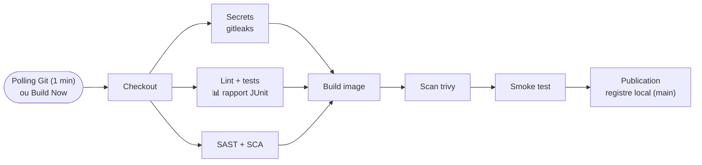

# US-04.3 — Démonstration du second outil : Jenkins

> **Jira :** [SCRUM-25](https://maalsi25.atlassian.net/browse/SCRUM-25) · **Epic :** EPIC 04, Comparaison et démonstration de deux solutions CI/CD
> **Responsable :** Membre D · **Binôme :** Membre B
> **Scénario de référence :** [US-04.1](US-04.1_candidats_et_criteres.md) · **Code :** [`demos/cicd/`](../../demos/cicd/) · **Pipeline :** [`Jenkinsfile`](../../demos/cicd/Jenkinsfile) · **Serveur :** [`jenkins/`](../../demos/cicd/jenkins/)

---

## 1. Contenu de la démo

| Élément | Fichier | Rôle |
|---|---|---|
| Pipeline | `Jenkinsfile` | **Mêmes étapes** que le workflow GitHub Actions |
| Image Jenkins | `jenkins/Dockerfile` + `plugins.txt` | Jenkins LTS, client Docker et 9 plugins installés au build |
| Configuration du serveur | `jenkins/casc.yaml` | **Jenkins Configuration as Code** : compte admin, sécurité, et **création automatique du job** (Job DSL). Aucun clic de configuration |
| Lancement | `jenkins/docker-compose.yml` | Jenkins + **registre d'images local** (équivalent de GHCR) |

Lancement : `cd demos/cicd/jenkins && docker compose up -d --build`, puis http://localhost:8080 (`admin` / `admin`). Voir le [README](../../demos/cicd/README.md), section 2.

---

## 2. Structure du pipeline

| Concept Jenkins | Utilisation dans la démo |
|---|---|
| **Pipeline déclaratif** (`Jenkinsfile`) | Le pipeline est du code versionné dans le dépôt, comme `ci.yml` |
| **`parallel`** | Les 3 contrôles de qualité tournent en parallèle sur le même serveur |
| **`agent { docker { … } }`** | Chaque étape tourne dans un **conteneur jetable** (Python, gitleaks), ce qui évite d'installer des outils sur le serveur |
| **`post { always { junit … } }`** | Les résultats de tests sont **historisés** et affichés en graphe par Jenkins |
| **`when { expression … }`** | Publication uniquement sur la branche `main` |
| **`options`** | Horodatage des logs, pas de builds concurrents, timeout de 20 min, rotation des 20 derniers builds |
| **Polling SCM** | Jenkins interroge le dépôt chaque minute. Un webhook est possible si Jenkins est joignable depuis la forge |

---

## 3. Déroulé de la démonstration (environ 3 min)

| # | Action | Ce que la direction voit |
|---|---|---|
| 1 | Montrer `casc.yaml` et `Jenkinsfile` | Le **serveur et le pipeline sont du code** : on peut recréer Jenkins à l'identique |
| 2 | Ouvrir le job `petite-maison-catalogue` → *Build Now* | **Déclenchement**, file d'attente, exécution |
| 3 | Vue des étapes (*Stage View* / *Pipeline Overview*) | **Étapes, branche parallèle, durées**, statut vert ou rouge |
| 4 | *Test Result* | **8 tests**, historique et tendance |
| 5 | `curl localhost:5000/v2/petite-maison/catalogue/tags/list` | **Résultat** : l'image `build-N` est publiée |
| 6 | `sh demo/scenario.sh regression` → commit | Jenkins **détecte seul** le commit (polling) et l'étape tests passe au **rouge**. Build et publication sont **sautés** |

---

## 4. Résultats de l'exécution réelle (03/11/2026, poste Windows 11 + Docker Desktop)

### Build #1 : pipeline vert ✅

| Étape | Statut | Durée |
|---|---|---|
| Checkout | ✅ | 0,4 s |
| Secrets (gitleaks) | ✅ | 3,7 s |
| Lint + tests unitaires (8/8, couverture 100 %) | ✅ | 20,4 s |
| SAST (bandit) + SCA (pip-audit) | ✅ | 25,0 s |
| Build de l'image | ✅ | 8,0 s |
| Scan de l'image (trivy) | ✅ | 18,3 s |
| Smoke test | ✅ | 3,6 s |
| Publication (registre local → `build-1`) | ✅ | 1,2 s |
| **Total** | **SUCCESS** | **64 s** |

*Les étapes parallèles se chevauchent : la phase de qualité dure environ 25 s, celle de la branche la plus lente.*

### Build #2 : scénario `regression` (TVA passée à 21 %)

- **Déclenchement :** automatique, *« Started by an SCM change »*. Le commit a été détecté par le polling sans aucune action manuelle.
- **Résultat :** ❌ **FAILURE en 22 s.** L'étape *Lint + tests unitaires* échoue : **6 tests réussis, 2 en échec** (`test_detail_produit_avec_ttc`, `test_prix_ttc[100.0-figurine-120.0]`). Jenkins affiche les tests en échec et la tendance par rapport au build précédent.
- **Quality gate :** build de l'image, scan, smoke test et publication **non exécutés** (environ 0,1 s chacun, marqués comme sautés). **Aucune image défectueuse n'est publiée.**
- Les autres branches parallèles (secrets, SAST/SCA) vont à leur terme : le développeur reçoit **tous les retours en un seul run**.

### Build #3 : scénario `secret` (faux jeton GitHub commité)

- **Déclenchement :** automatique (polling).
- **Résultat :** ❌ **FAILURE en 22 s.**
  - Étape *Secrets (gitleaks)* : `leaks found: 1`, jeton détecté et **masqué dans les logs** (`--redact`).
  - Étape *Lint + tests* : **également en échec**, car la règle de sécurité **S105 de ruff** (*« possible hardcoded password »*) a détecté la même erreur.
- **Constat :** le secret est arrêté par **deux contrôles indépendants**. C'est la **défense en profondeur** voulue par la démarche DevSecOps (US-02.2). Aucune image n'est construite ni publiée.
- ⚠️ **Limite :** le secret est **déjà dans l'historique Git**. Le pipeline empêche sa diffusion dans un livrable, mais un vrai jeton devrait quand même être **révoqué immédiatement**. D'où l'intérêt de détecter **avant le commit** (hook local) ou **avant le push** (*push protection* de GitHub).

### Build #4 : retour au vert

- **Résultat :** ✅ **SUCCESS en 27,5 s** (contre 64 s pour le build #1). Build de l'image : 0,4 s (couches en cache). Scan trivy : 0,8 s (base de vulnérabilités en cache). L'image `build-4` est publiée.

### Synthèse des 4 builds

| Build | Scénario | Déclenchement | Résultat | Durée |
|---|---|---|---|---|
| #1 | Nominal (premier lancement) | Manuel (API) | ✅ SUCCESS, image `build-1` publiée | 64 s |
| #2 | `regression` | Commit (polling) | ❌ Tests (2/8 en échec), livraison bloquée | 22 s |
| #3 | `secret` | Commit (polling) | ❌ gitleaks + ruff S105, livraison bloquée | 22 s |
| #4 | Retour au vert (cache chaud) | Commit (polling) | ✅ SUCCESS, image `build-4` publiée | 27,5 s |

---

## 5. Points de friction consignés

| # | Friction rencontrée | Impact | Solution appliquée |
|---|---|---|---|
| 1 | **Mise en place longue** : image personnalisée, choix des plugins, configuration JCasC, Job DSL | Environ 1 à 2 h la première fois, contre environ 15 min pour GitHub Actions | Tout est figé dans `jenkins/` : la suivante prend 5 min |
| 2 | **Docker dans Jenkins conteneurisé** : les étapes lancent des conteneurs via le **socket Docker de l'hôte** | ⚠️ Le conteneur Jenkins a, de fait, les **droits root sur l'hôte** (démo lancée en `user: root`) | Acceptable **uniquement en démo**. En production : agents dédiés et isolés, ou exécution sans socket partagé |
| 3 | **Protection CSRF** : déclencher un build par API exige un jeton *crumb* | Script d'automatisation un peu plus complexe | Récupération du crumb avant l'appel |
| 4 | **Checkout d'un dépôt local** bloqué par défaut (sécurité du plugin Git) | Démo hors-ligne impossible sans option | Option `ALLOW_LOCAL_CHECKOUT` activée **pour la démo uniquement** |
| 5 | **Premier build lent** (téléchargement des images Python, gitleaks, trivy et de la base de vulnérabilités) | Risque le jour J | Volume de cache trivy + **build de préchauffage la veille** |
| 6 | **Pas de webhook** sans exposer Jenkins sur Internet | Délai de détection jusqu'à 1 min (polling) | Acceptable. En production : webhook via un reverse proxy sécurisé |
| 7 | **Plugins = dette de maintenance** (9 plugins et leurs dépendances, qui reçoivent des alertes de sécurité régulières) | Mises à jour fréquentes à tester | Versions figées dans l'image, mises à jour planifiées |

---

## 6. Solution de secours de démonstration

| Aléa le jour J | Solution |
|---|---|
| Pas d'Internet | Jenkins tourne **entièrement en local** (images téléchargées la veille, dépôt monté en local) : c'est la **démo de secours de l'EPIC** |
| Jenkins ne démarre pas | Vidéo d'un run complet + captures de *Stage View* et des résultats de tests |
| Run trop long en direct | Build vert lancé avant la présentation. En direct, on ne montre que le scénario rouge (échec en moins de 30 s) |

**Checklist de la veille :** `docker compose up -d --build`, un build complet vert, captures d'écran, vidéo d'1 à 2 min, puis `docker compose stop` (sans `-v`, pour garder le cache).
