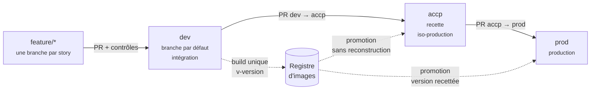

# Branches, environnements et chaîne de livraison (dev → accp → prod)

> **Story :** US-04.5 · **Epic :** EPIC 04, CI/CD · **Entrées :** [US-02.2, cycle DevSecOps](../qualite-devsecops/cycle-devsecops.md) · [US-04.4, choix CI/CD](comparaison-et-choix.md) · [US-06.3, tests dans le pipeline](../kubernetes-et-tests/tests-dans-le-pipeline.md)
> **Mise en œuvre :** [`.github/workflows/boutique.yml`](../../.github/workflows/boutique.yml) · [`Jenkinsfile`](../../Jenkinsfile) · scripts communs [`infra/ci/images.sh`](../../infra/ci/images.sh) et [`infra/ci/deployer.sh`](../../infra/ci/deployer.sh) · surcouches [`infra/k8s/overlays/`](../../infra/k8s/overlays/)

**But :** livrer la boutique en passant par trois environnements, chacun associé à une branche Git, avec les mêmes garanties sur GitHub Actions et sur Jenkins.

---

## 1. Les branches et leur rôle

| Branche | Qui y écrit | Ce que fait le pipeline | Environnement |
|---|---|---|---|
| `feature/*` | Le développeur | Contrôles qualité et sécurité, build des images, scan, test de bout en bout. **Aucune publication** | Aucun |
| **`dev`** (par défaut) | Fusion des PR de fonctionnalités | Tout ce qui précède, puis **publication des images `v-<version>`** et déploiement automatique | **dev** : Docker Compose, front sur le port 3100 |
| **`accp`** | PR `dev → accp` | Contrôles qualité, puis **promotion des images de dev** (pas de reconstruction), déploiement, **recette** automatique. Si elle réussit, la version reçoit l'étiquette `accp-<version>` | **accp** : Kubernetes, namespaces `accp-*`, topologie identique à la production avec 1 instance par service |
| **`prod`** | PR `accp → prod` | Contrôle que la version **a été recettée**, **approbation manuelle**, déploiement progressif, test de fumée, **retour arrière automatique** en cas d'échec | **prod** : Kubernetes, namespaces `prod-*`, 2 instances, mise à l'échelle automatique |

**Version d'une livraison :** c'est l'empreinte Git des **sources des images** (`apps/`, `infra/kong`, `infra/postgres`, ainsi que `package.json` et `package-lock.json` du monorepo). Modifier la documentation, les scripts de CI ou les manifestes Kubernetes ne change donc pas la version. Une fusion `dev → accp → prod` qui n'apporte aucune modification garde **la même version**. Le pipeline sait donc qu'il s'agit des mêmes images.

---

## 2. Construire une fois, déployer partout

| Étiquette d'image | Posée par | Signification |
|---|---|---|
| `v-<version>` | Pipeline `dev` (ou toute branche dont la version n'existe pas encore) | Image construite, scannée, testée de bout en bout |
| `dev` | Déploiement dev réussi | Version actuellement en dev |
| `accp`, `accp-<version>` | Recette réussie | Version **recettée** : seule une version portant cette étiquette peut aller en production |
| `prod`, `prod-<version>` | Mise en production réussie | Version en production. Un tag Git `livraison-<date>-<version>` est aussi posé (GitHub Actions) |

**Pourquoi :** une image reconstruite pour la production ne serait pas **exactement** celle qui a été recettée (dépendances téléchargées à nouveau, image de base mise à jour entre-temps). La promotion garantit que la production exécute **les octets testés en recette**.

**Correctif urgent :** une correction faite directement sur `accp` produit une version inconnue. Le pipeline reconstruit alors les images (avec scan et test de bout en bout), puis les promeut. Rien n'arrive en production sans être passé par la recette.

---

## 3. Les environnements

| | dev | accp (recette) | prod |
|---|---|---|---|
| Plateforme | Docker Compose (serveur de dev) | Kubernetes | Kubernetes |
| Topologie | Toute la boutique, un conteneur par service | **Identique à la production** : 3 zones (namespaces `accp-publique`, `accp-applicative`, `accp-donnees`), cloisonnement réseau | 3 zones (`prod-*`), cloisonnement réseau |
| Instances | 1 | 1 par service | 2 par service exposé, mise à l'échelle de 2 à 6 (catalogue) |
| Isolation | Réseau Docker propre | Ne peut **pas** joindre les données de production (NetworkPolicy par environnement) | Idem |
| Déploiement | Automatique à chaque fusion | Automatique à chaque fusion | **Après approbation** |
| Vérification | Test de bout en bout | Test de bout en bout dans le cluster (recette) | Test de fumée, **retour arrière automatique** si échec |
| Configuration | `infra/compose/dev.yml` | `infra/k8s/overlays/accp/` | `infra/k8s/overlays/prod/` |

Les surcouches Kustomize partent d'une **base commune** (`infra/k8s/base/`). Seuls changent les noms de zones, le nombre d'instances, le port exposé et l'étiquette d'environnement des règles réseau. Il n'y a donc **aucun écart de configuration caché** entre recette et production.

---

## 4. Mise en œuvre dans les deux outils

| Mécanisme | GitHub Actions | Jenkins |
|---|---|---|
| Une chaîne par branche | Déclencheurs `push` et `pull_request` sur `dev`, `accp`, `prod` ; jobs conditionnés par `github.ref_name` | Job **multi-branches** qui découvre `dev`, `accp`, `prod` et `feature/*` ; étapes conditionnées par `when { branch … }` |
| Environnements | **Environnements GitHub** `dev`, `accp`, `production` : historique des déploiements, secrets propres à chaque environnement | Étapes dédiées, cluster cible configuré une fois (`connecter-minikube.sh`) |
| Cible de déploiement | Avec le secret `KUBECONFIG` de l'environnement : le vrai cluster. Sans : un **cluster éphémère** (kind) créé dans le runner, pour valider le déploiement | Le cluster Kubernetes local (minikube) et le Docker de l'hôte |
| Approbation de la production | Relecteurs obligatoires de l'environnement `production` (offre Pro ou dépôt public). **Dans notre dépôt privé gratuit**, mesure compensatoire : déclenchement manuel (*Run workflow*) limité à la liste `APPROBATEURS_PROD` | Étape **`input`** native, réservée à l'utilisateur `admin`, expiration au bout de 30 min |
| Tests des applications | `turbo run test` (front et backend, cache turbo) | Front : `turbo run test` ; backend : la même commande Maven dans l'image Maven |
| Promotion des images | `infra/ci/images.sh` (GHCR) | `infra/ci/images.sh` (registre local) |

> **Constat :** dans un dépôt privé de l'offre gratuite, GitHub refuse à la fois la **protection des branches** et l'**approbation** des environnements (« *Upgrade to GitHub Pro or make this repository public* »). Jenkins offre ces contrôles sans licence, mais il faut l'exploiter. Ce point complète la comparaison de [US-04.4](comparaison-et-choix.md).

---

## 5. Règles de travail de l'équipe

1. **On ne pousse jamais directement** sur `accp` ni sur `prod` : uniquement par PR depuis la branche précédente. *(Règle d'équipe, car la protection de branche n'est pas disponible dans notre offre GitHub.)*
2. Une fonctionnalité = une branche `feature/<ticket>` → PR vers `dev`, relue par un pair, pipeline vert.
3. La fusion `dev → accp` est décidée par le PO avec l'équipe, en fin de sprint.
4. La fusion `accp → prod` suit la **validation de la recette** par le PO. La mise en production est déclenchée par un **approbateur** (liste `APPROBATEURS_PROD`).
5. Un incident en production → correctif sur `feature/hotfix-…`, puis le même chemin accéléré (dev → accp → prod le même jour). Le retour arrière automatique protège la production en attendant.

---

## 6. Résultats de l'exécution (27/11/2026)

Version promue : **`8f4531fb865e`**, construite une seule fois sur `dev`.

### Jenkins (multi-branches, déploiements réels sur le poste : Docker Compose et minikube)

| Branche | Étapes exécutées | Résultat | Durée |
|---|---|---|---|
| `dev` | Contrôles ‖ → build des 9 images, scan, test de bout en bout, publication `v-8f4531fb865e` → **déploiement dev** + test de bout en bout | Vert | 3 min 18 |
| `accp` | Contrôles ‖ → images **trouvées dans le registre : build sauté** → **déploiement recette** (Kubernetes `accp-*`) → recette OK → étiquette `accp-8f4531fb865e` | Vert | 5 min 50 |
| `prod` | Contrôles ‖ → images trouvées → **version recettée confirmée** → **arrêt sur l'approbation** « Mettre en production la version 8f4531fb865e (recette validée) ? » | En attente d'un approbateur | — |

### GitHub Actions (runners GitHub, cluster Kubernetes éphémère kind)

| Branche | Jobs | Résultat |
|---|---|---|
| `dev` | 4 contrôles ‖ → images : build, scan, test de bout en bout, **publication GHCR** (5 min 23) → **déploiement dev** (3 min 07) | Vert |
| `accp` | 4 contrôles ‖ → images : **promotion sans reconstruction** (35 s) → **recette** : cluster éphémère, déploiement `accp-*`, test, étiquette (4 min 36) | Vert |
| `prod` | 4 contrôles ‖ → images trouvées → **contrôle de la version candidate** : recettée | Vert. La mise en production attend le déclenchement manuel d'un approbateur |

### Incidents rencontrés et corrigés

| Incident | Cause | Correction |
|---|---|---|
| Publication GHCR refusée (`denied`) au premier run | Le jeton du workflow ne peut pas créer de paquet à la racine du compte | Images nommées sous le dépôt : `ghcr.io/<compte>/<dépôt>/boutique-*` |
| Aucun pipeline lancé à la création de la branche `accp` | Le filtre `paths` compare la nouvelle branche à `dev` : une promotion ne modifie aucun fichier | Filtre retiré des pushs (conservé sur les PR) |
| Reconstruction inutile en recette après une modification du README | La version couvrait tout le dossier de la boutique | Version calculée sur les seules sources des images |
| Jenkins ne joignait pas le cluster | Jenkins tourne dans un conteneur, hors du réseau du cluster | `connecter-minikube.sh` : réseau Docker du cluster + kubeconfig dédié |
| Approbation de la production non disponible sur GitHub | Dépôt privé, offre gratuite | Mesure compensatoire (déclenchement manuel limité aux approbateurs). Jenkins : étape `input` native |

---

[← Conclusion comparative CI/CD](comparaison-et-choix.md) · [Sommaire](../README.md) · [Choix du domaine technique et des critères de comparaison →](../bus-evenements/domaine-et-criteres.md)
