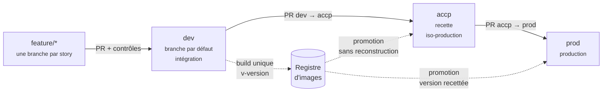

# Branches, environnements et chaîne de livraison (dev → accp → prod)

> **Story :** US-04.5 · **Epic :** EPIC 04, CI/CD · **Entrées :** [US-02.2, cycle DevSecOps](../qualite-devsecops/cycle-devsecops.md) · [US-04.4, choix CI/CD](comparaison-et-choix.md) · [US-06.3, tests dans le pipeline](../kubernetes-et-tests/tests-dans-le-pipeline.md)
> **Mise en œuvre :** [`.github/workflows/`](../../.github/workflows/) · [`Jenkinsfile`](../../Jenkinsfile) · scripts communs [`infra/ci/images.sh`](../../infra/ci/images.sh) et [`infra/ci/deployer.sh`](../../infra/ci/deployer.sh) · surcouches [`infra/k8s/overlays/`](../../infra/k8s/overlays/)

**But :** livrer la boutique en passant par trois branches Git : `dev` pour l'intégration continue, puis `accp` (recette) et `prod` (production) pour le déploiement continu, avec les mêmes garanties sur GitHub Actions et sur Jenkins.

---

## 1. Les branches et leur rôle

| Branche | Qui y écrit | Ce que fait le pipeline | Environnement |
|---|---|---|---|
| `feature/*` | Le développeur | Contrôles qualité et sécurité, build des images, scan, test de bout en bout. **Aucune publication** | Aucun |
| **`dev`** (par défaut) | Fusion des PR de fonctionnalités | **Intégration continue** : tout ce qui précède, puis **publication des images `v-<version>`**. **Aucun déploiement** | Aucun |
| **`accp`** | PR `dev → accp` | Contrôles qualité, puis **promotion des images de dev** (pas de reconstruction), déploiement, **recette** automatique. Si elle réussit, la version reçoit l'étiquette `accp-<version>` | **accp** : Kubernetes, namespaces `accp-*`, topologie identique à la production avec 1 instance par service |
| **`prod`** | PR `accp → prod` | Contrôle que la version **a été recettée**, **approbation manuelle**, déploiement progressif, test de fumée, **retour arrière automatique** en cas d'échec | **prod** : Kubernetes, namespaces `prod-*`, 2 instances, mise à l'échelle automatique |

**Version d'une livraison :** c'est l'empreinte Git des **sources des images** (`apps/`, `infra/kong`, `infra/postgres`, ainsi que `package.json` et `package-lock.json` du monorepo). Modifier la documentation, les scripts de CI ou les manifestes Kubernetes ne change donc pas la version. Une fusion `dev → accp → prod` qui n'apporte aucune modification garde **la même version**. Le pipeline sait donc qu'il s'agit des mêmes images.

---

## 2. Construire une fois, déployer partout

| Étiquette d'image | Posée par | Signification |
|---|---|---|
| `v-<version>` | Pipeline `dev` (ou toute branche dont la version n'existe pas encore) | Image construite, scannée, testée de bout en bout |
| `accp`, `accp-<version>` | Recette réussie | Version **recettée** : seule une version portant cette étiquette peut aller en production |
| `prod`, `prod-<version>` | Mise en production réussie | Version en production. Un tag Git `livraison-<date>-<version>` est aussi posé (GitHub Actions) |

**Pourquoi :** une image reconstruite pour la production ne serait pas **exactement** celle qui a été recettée (dépendances téléchargées à nouveau, image de base mise à jour entre-temps). La promotion garantit que la production exécute **les octets testés en recette**.

**Correctif urgent :** une correction faite directement sur `accp` produit une version inconnue. Le pipeline reconstruit alors les images (avec scan et test de bout en bout), puis les promeut. Rien n'arrive en production sans être passé par la recette.

---

## 3. Les environnements

La branche `dev` fait de l'**intégration continue** : elle construit, teste et publie les images, mais ne déploie rien. Le **déploiement continu** commence en recette.

| | accp (recette) | prod |
|---|---|---|
| Plateforme | Kubernetes | Kubernetes |
| Topologie | **Identique à la production** : 3 zones (namespaces `accp-publique`, `accp-applicative`, `accp-donnees`), cloisonnement réseau | 3 zones (`prod-*`), cloisonnement réseau |
| Instances | 1 par service | 2 par service exposé, mise à l'échelle de 2 à 6 (catalogue) |
| Isolation | Ne peut **pas** joindre les données de production (NetworkPolicy par environnement) | Idem |
| Déploiement | Automatique à chaque fusion sur `accp` | **Après approbation** |
| Vérification | Test de bout en bout dans le cluster (recette) | Test de fumée, **retour arrière automatique** si échec |
| Configuration | `infra/k8s/overlays/accp/` | `infra/k8s/overlays/prod/` |

Les surcouches Kustomize partent d'une **base commune** (`infra/k8s/base/`). Seuls changent les noms de zones, le nombre d'instances, le port exposé et l'étiquette d'environnement des règles réseau. Il n'y a donc **aucun écart de configuration caché** entre recette et production.

---

## 4. Mise en œuvre dans les deux outils

| Mécanisme | GitHub Actions | Jenkins |
|---|---|---|
| Une chaîne par branche | Orchestrateur `pipeline.yml` : déclencheurs `push` et `pull_request` sur `dev`, `accp`, `prod`, appels conditionnés par `github.ref_name` vers des workflows réutilisables | Job **multi-branches** qui découvre `dev`, `accp`, `prod` et `feature/*` ; étapes conditionnées par `when { branch … }` |
| Environnements | **Environnements GitHub** `dev`, `accp`, `production` : historique des déploiements, secrets propres à chaque environnement | Étapes dédiées, cluster cible configuré une fois (`connecter-minikube.sh`) |
| Cible de déploiement | Avec le secret `KUBECONFIG` de l'environnement : le vrai cluster. Sans : un **cluster éphémère** (kind) créé dans le runner. Dans les deux cas, **le cluster tire les images sur GHCR** grâce à un secret d'accès au registre | Le cluster Kubernetes local (minikube) et le Docker de l'hôte |
| Approbation de la production | Relecteurs obligatoires de l'environnement `production` (offre Pro ou dépôt public). **Dans notre dépôt privé gratuit**, mesure compensatoire : workflow `mise-en-production.yml`, déclenché à la main et réservé à la liste `APPROBATEURS_PROD` | Étape **`input`** native, réservée à l'utilisateur `admin`, expiration au bout de 30 min |
| Tests des applications | `turbo run test` (front et backend, cache turbo) | Front : `turbo run test` ; backend : la même commande Maven dans l'image Maven |
| Promotion des images | `infra/ci/images.sh` (GHCR) | `infra/ci/images.sh` (registre local) |
| Récupération des images par le cluster | Le cluster tire les images sur GHCR (`imagePullSecret` créé par `infra/ci/deployer.sh`) | Images chargées dans les nœuds minikube (le registre local n'est pas joignable depuis le cluster) |

> **Constat :** dans un dépôt privé de l'offre gratuite, GitHub refuse à la fois la **protection des branches** et l'**approbation** des environnements (« *Upgrade to GitHub Pro or make this repository public* »). Jenkins offre ces contrôles sans licence, mais il faut l'exploiter. Ce point complète la comparaison de [US-04.4](comparaison-et-choix.md).

---

## 5. Règles de travail de l'équipe

1. **On ne pousse jamais directement** sur `accp` ni sur `prod` : uniquement par PR depuis la branche précédente. *(Règle d'équipe, car la protection de branche n'est pas disponible dans notre offre GitHub.)*
2. Une fonctionnalité = une branche `feature/<ticket>` → PR vers `dev`, relue par un pair, pipeline vert.
3. La fusion `dev → accp` est décidée par le PO avec l'équipe, en fin de sprint.
4. La fusion `accp → prod` suit la **validation de la recette** par le PO. La mise en production est déclenchée par un **approbateur** (liste `APPROBATEURS_PROD`).
5. Un incident en production → correctif sur `feature/hotfix-…`, puis le même chemin accéléré (dev → accp → prod le même jour). Le retour arrière automatique protège la production en attendant.

---

[← Conclusion comparative CI/CD](comparaison-et-choix.md) · [Sommaire](../README.md) · [Choix du domaine technique et des critères de comparaison →](../bus-evenements/domaine-et-criteres.md)
