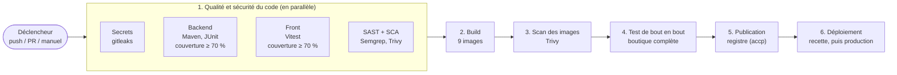

# Sélection des deux chaînes CI/CD et des critères

> **Story :** US-04.1 · **Jira :** [SCRUM-23](https://maalsi25.atlassian.net/browse/SCRUM-23) · **Epic :** EPIC 04, Comparaison et démonstration de deux solutions CI/CD
> **Responsable :** Membre B · **Binôme :** Membre D
> **Entrées :** [US-02.1, attributs de qualité](../qualite-devsecops/attributs-de-qualite.md) · [US-02.2, cycle DevSecOps](../qualite-devsecops/cycle-devsecops.md) · [US-02.3, métiers](../qualite-devsecops/metiers-et-interactions.md)

---

## 1. Solutions retenues

On compare deux **chaînes CI/CD complètes**, de l'intégration continue jusqu'au déploiement en production.

| | **GitHub Actions** | **Jenkins + Argo CD** |
|---|---|---|
| **Modèle de CI** | Service **SaaS** intégré à la forge GitHub | Serveur **open source auto-hébergé** (Jenkins) |
| **Modèle de déploiement** | **« Push »** : le pipeline applique lui-même les manifestes dans le cluster (`kubectl`) | **GitOps, « pull »** : Argo CD, installé **dans le cluster**, tire l'état souhaité depuis Git et l'applique |
| **Éditeurs** | GitHub (Microsoft, États-Unis) | Communauté open source : Jenkins (CD Foundation), Argo CD (CNCF, projet *graduated*) |
| **Définition** | Fichiers YAML dans le dépôt (`.github/workflows/`) | `Jenkinsfile` (Groovy) + applications Argo CD (YAML, `infra/argocd/`) |
| **Exécution** | Runners hébergés par GitHub, ou runners auto-hébergés | Contrôleur Jenkins et ses agents ; Argo CD dans le cluster |
| **Extensibilité** | Marketplace d'« actions » réutilisables | Environ 2 000 plugins Jenkins ; Argo CD : Kustomize, Helm, notifications, Image Updater |

### Pourquoi ces deux chaînes ?

1. **Elles opposent deux modèles, à deux niveaux**, ce qui rend la comparaison instructive pour la direction :
   - pour la CI : *service managé clé en main* contre *outil maîtrisé et hébergé où l'on veut* ;
   - pour le déploiement : *pipeline qui pousse vers le cluster* contre *cluster qui tire son état depuis Git* (GitOps).
2. **Elles répondent à des contraintes du projet qui s'opposent :**
   - **C-11 Petite équipe** (US-01.1), sans DevOps à plein temps au démarrage (US-02.3) : avantage au **SaaS**, sans serveur à maintenir.
   - **C-04 Hébergement en Europe** et **C-03 sécurité forte** : avantage à l'**auto-hébergement** et au **GitOps**, où la CI ne détient aucun accès au cluster de production.
3. **Ce sont des références du marché** : Jenkins est historiquement l'outil CI le plus répandu, GitHub Actions le plus adopté parmi les solutions récentes, et Argo CD l'outil GitOps le plus utilisé sur Kubernetes.

> **Autres solutions écartées :** *GitLab CI* (proche de GitHub Actions dans son modèle, mais impose de migrer toute la forge) · *Flux CD* (alternative GitOps à Argo CD, sans interface graphique intégrée : moins démonstratif) · *CircleCI* (SaaS proche de GitHub Actions, moins répandu).

---

## 2. Critères de comparaison

Chaque critère est relié à un enjeu du projet et noté de 1 (faible) à 5 (excellent) dans [US-04.4](comparaison-et-choix.md).

| # | Critère | Ce qu'on évalue | Enjeu du projet | Poids |
|---|---|---|---|---|
| K1 | **Simplicité de mise en place** | Temps et compétences pour obtenir un premier pipeline vert | C-11 Petite équipe, alternants | ×3 |
| K2 | **Intégration au dépôt de code** | Déclenchement sur push et PR, statut affiché sur la PR, lien code ↔ pipeline | Revue de code obligatoire (US-02.2, étape 2) | ×2 |
| K3 | **Sécurité de la chaîne CI/CD** | Gestion des secrets, isolation des exécutions, permissions, surface d'attaque, mises à jour | C-03 Sécurité forte, démarche DevSecOps | ×3 |
| K4 | **Maintenance et exploitation** | Charge pour maintenir l'outil (mises à jour, plugins, sauvegardes, disponibilité) | C-11, pas de DevOps à plein temps au départ | ×3 |
| K5 | **Souveraineté et hébergement** | Localisation des exécutions et des données (code, logs, artefacts), dépendance à un fournisseur | C-04 Hébergement en Europe, RGPD | ×2 |
| K6 | **Coût** | Licence, infrastructure, temps humain | Petite structure | ×2 |
| K7 | **Richesse fonctionnelle et extensibilité** | Parallélisme, matrices, artefacts, intégrations (scans, registres, cloud) | Pipeline DevSecOps complet (US-02.2) | ×1 |
| K8 | **Observabilité du pipeline** | Lisibilité de l'interface, logs, rapports de tests, historique, **état déployé visible** | Détection rapide des blocages, feedback aux développeurs | ×1 |
| K9 | **Fiabilité du déploiement** | Détection et correction des écarts entre le cluster et Git, retour arrière, traçabilité de ce qui est déployé, accès au cluster nécessaires à la CI | Disponibilité pendant les ventes (US-02.1), sécurité de la production (C-03) | ×2 |

---

## 3. Scénario de comparaison (identique pour les deux outils)

### 3.1 Application support

La **boutique de démonstration** ([`apps/` et `infra/`](../../README.md)) : un front React et des microservices Spring Boot (identité, catalogue, commandes, notifications, expédition), une passerelle d'API, PostgreSQL et un bus d'événements. C'est le **même support** pour les deux pipelines, et aussi pour les comparaisons techniques (EPIC 05) et la démo Kubernetes (EPIC 06). Le pipeline livre donc une **vraie application multi-services** : 9 images conteneur.

### 3.2 Étapes du pipeline de référence

Ces étapes reprennent les étapes 3 à 6 du [cycle DevSecOps (US-02.2)](../qualite-devsecops/cycle-devsecops.md) :

| # | Étape | Outil (identique des deux côtés) | Quality gate (bloquant si…) |
|---|---|---|---|
| 1a | Recherche de secrets | gitleaks | un secret est détecté |
| 1b | Backend : tests unitaires et d'intégration + couverture | Maven, JUnit, JaCoCo | test en échec ou couverture de lignes < 70 % dans un service |
| 1c | Front : tests + couverture | Vitest | test en échec ou couverture de lignes < 70 % |
| 1d | SAST + SCA | Semgrep (règles Java, React, secrets), Trivy (dépendances Maven et npm) | vulnérabilité de sévérité ERROR dans le code, ou dépendance **critique** corrigeable |
| 2 | Build des images | Docker Compose | échec de construction |
| 3 | Scan des images | Trivy (script commun `infra/ci/scan-images.sh`) | vulnérabilité **critique** corrigeable, hors exception justifiée et datée (`.trivyignore.yaml`) |
| 4 | Test de bout en bout | script commun `infra/ci/smoke-test.sh` : la boutique complète démarre, un parcours client est joué (connexion, commande, événement reçu par le bus, accès refusé sans jeton) | un contrôle échoue ou la boutique ne démarre pas en 5 min |
| 5 | Publication | registre d'images | — (branches `accp` et `prod` uniquement) |
| 6 | Déploiement | GitHub Actions : `kubectl` depuis le pipeline · Jenkins + Argo CD : synchronisation par Argo CD | test de fumée en échec (retour arrière en production) |

**Équivalences entre outils :**

| Élément | GitHub Actions | Jenkins + Argo CD |
|---|---|---|
| Registre d'images | GitHub Container Registry (GHCR) | Registre local (conteneur `registry:2`) |
| Déclenchement | Push et PR (webhook natif) | Polling Git toutes les minutes (un webhook est possible si Jenkins est accessible depuis la forge) |
| Parallélisme | 4 jobs parallèles | 4 branches `parallel` |
| Déploiement | Le pipeline applique les manifestes (`infra/ci/deployer.sh`) avec les accès au cluster | Jenkins transmet la version à Argo CD (`infra/ci/deployer-argocd.sh`), qui applique l'état décrit dans Git |
| Approbation de la production | Relecteur obligatoire de l'environnement `production` | Étape `input` de Jenkins, puis synchronisation manuelle de l'application Argo CD |

### 3.3 Mesures relevées pendant les démos

Pour chaque outil, on consigne :
- le **temps de mise en place** (de zéro au premier pipeline vert) ;
- la **durée d'un pipeline** (premier lancement et lancements suivants) ;
- le **comportement en cas d'échec** : scénarios `regression` (test métier cassé) et `secret` (jeton commité), via `tools/demo/scenario.sh` ;
- les **points de friction** rencontrés.

Analyse : [US-04.2](demo-github-actions.md) · [US-04.3](demo-jenkins-argocd.md) · [US-04.4](comparaison-et-choix.md)

---

[← Vérification de la couverture du besoin](../architecture/couverture-du-besoin.md) · [Sommaire](../README.md) · [Démonstration du premier outil : GitHub Actions →](demo-github-actions.md)
