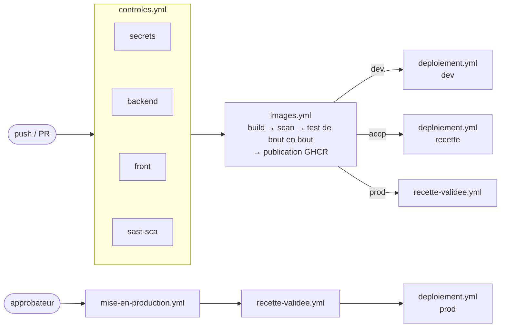

# Démonstration du premier outil : GitHub Actions

> **Story :** US-04.2 · **Jira :** [SCRUM-24](https://maalsi25.atlassian.net/browse/SCRUM-24) · **Epic :** EPIC 04, Comparaison et démonstration de deux solutions CI/CD
> **Responsable :** Membre B · **Binôme :** Membre D
> **Scénario de référence :** [US-04.1](candidats-et-criteres.md) · **Application :** [boutique de démonstration](../../README.md) · **Pipeline :** [`.github/workflows/`](../../.github/workflows/) (orchestrateur : [`pipeline.yml`](../../.github/workflows/pipeline.yml))

---

## 1. Contenu de la démo

| Élément | Fichier |
|---|---|
| Application livrée : **boutique front + microservices** (support identique aux deux outils) | `apps/front/`, `apps/back/`, `infra/kong/`, `infra/postgres/` |
| Pipeline GitHub Actions | `.github/workflows/ci.yml` |
| Étapes communes aux deux outils | `infra/ci/scan-images.sh` (scan des images), `infra/ci/smoke-test.sh` + `infra/ci/smoke.py` (test de bout en bout) |
| Registre des vulnérabilités acceptées | `.trivyignore.yaml` |
| Scénarios d'échec | `tools/demo/scenario.sh` |
| Procédure complète | [`README.md` de la boutique](../../README.md), section 4 |

La boutique est poussée dans **son propre dépôt GitHub** (README, section 4). Le pipeline livre la **vraie application de démonstration** : 9 images (front, passerelle, 5 services Spring Boot, Kong, PostgreSQL).

---

## 2. Structure du pipeline

Le pipeline est découpé en **workflows réutilisables** (`workflow_call`) : chaque fichier a une seule responsabilité, et les étapes de déploiement sont écrites une seule fois pour les trois environnements.

| Fichier | Rôle | Appelé par |
|---|---|---|
| [`pipeline.yml`](../../.github/workflows/pipeline.yml) | **Orchestrateur** : déclencheurs (`push` sur `dev`, `accp`, `prod`, `pull_request`) et enchaînement des étapes selon la branche | GitHub (push, PR) |
| [`controles.yml`](../../.github/workflows/controles.yml) | **1. Qualité et sécurité du code** : secrets, backend, front, SAST + SCA, en parallèle | `pipeline.yml` |
| [`images.yml`](../../.github/workflows/images.yml) | **2. Images** : build unique, scan, test de bout en bout, publication sur **GHCR** ; promotion sans reconstruction sur `accp` et `prod` | `pipeline.yml` |
| [`deploiement.yml`](../../.github/workflows/deploiement.yml) | **3. Déploiement** d'un environnement (`dev`, `accp` ou `prod`) à partir des images de GHCR, test de fumée, étiquettes | `pipeline.yml`, `mise-en-production.yml` |
| [`recette-validee.yml`](../../.github/workflows/recette-validee.yml) | Contrôle : seule une version recettée (`accp-<version>`) peut aller en production | `pipeline.yml`, `mise-en-production.yml` |
| [`mise-en-production.yml`](../../.github/workflows/mise-en-production.yml) | **Mise en production** déclenchée à la main par un approbateur, puis tag Git de livraison | Un approbateur (`workflow_dispatch`) |

**Des images publiées sur GHCR au cluster :** le job images publie `ghcr.io/<compte>/<dépôt>/boutique-*:v-<version>`. Pour la recette et la production, `deploiement.yml` ne transfère aucune image : il crée dans chaque namespace un **secret d'accès au registre** (`imagePullSecret`), et **le cluster tire lui-même les images sur GHCR** au moment de démarrer les pods. Sans secret `KUBECONFIG`, la cible est un cluster éphémère (kind) créé dans le runner, qui se comporte comme un vrai cluster ; avec le secret `KUBECONFIG` de l'environnement, c'est le vrai cluster, et un jeton de lecture durable (`GHCR_LECTURE`) remplace le jeton du workflow, qui expire à la fin du job.

| Concept GitHub Actions | Utilisation dans la démo |
|---|---|
| **Workflows réutilisables** (`workflow_call`) | Un fichier par étape, appelé avec des paramètres (`environnement`, `version`) ; `secrets: inherit` transmet les secrets de l'environnement |
| **Jobs** | Les 4 contrôles tournent **en parallèle** sur des runners distincts |
| **`needs:`** | Les images ne sont construites que si les 4 contrôles sont verts : c'est la **quality gate** |
| **Environnements** | `dev`, `accp`, `production` : historique des déploiements, secrets propres (`KUBECONFIG`, `GHCR_LECTURE`) |
| **Actions du marketplace** | `actions/checkout`, `actions/setup-java` et `actions/setup-node` (avec **cache Maven et npm**), `actions/upload-artifact`, `docker/login-action`, `helm/kind-action` |
| **`permissions:`** | Lecture seule par défaut. `packages: write` est accordé **uniquement** aux jobs qui publient ou étiquettent les images (moindre privilège) |
| **`secrets.GITHUB_TOKEN`** | Jeton éphémère généré par GitHub pour publier et lire sur GHCR. **Aucun secret à créer** pour la démo |
| **`$GITHUB_STEP_SUMMARY`** | Version, images publiées et version recettée affichées sur la page du run |
| **`if:`** | La publication n'a lieu que sur un `push`, jamais sur une PR |

## 3. Déroulé de la démonstration (environ 3 min)

| # | Action | Ce que la direction voit |
|---|---|---|
| 1 | Montrer `.github/workflows/` dans le dépôt | Le pipeline est **du code**, découpé par étape, versionné et relu comme le reste |
| 2 | Ouvrir le run `dev` lancé avant la soutenance | Graphe des **4 contrôles parallèles**, puis des images et du déploiement dev |
| 3 | Ouvrir le job images, étape « test de bout en bout » | La **boutique complète** démarre dans le runner : connexion, commande, notification reçue par le bus |
| 4 | Montrer *Packages* | Les 9 images versionnées sont publiées sur GHCR |
| 5 | Ouvrir le run `accp` | Les **mêmes images** sont promues sans reconstruction, puis tirées de GHCR par le cluster de recette |
| 6 | Ouvrir une PR contenant la régression (`sh tools/demo/scenario.sh regression`) | Le **statut rouge s'affiche directement sur la PR** : on ne peut pas fusionner en confiance |

## 4. Contrôles du pipeline et comportement attendu

| Contrôle | Outil | Bloque la livraison si… |
|---|---|---|
| Syntaxe et expressions du workflow | `actionlint` (avec shellcheck), avant chaque push | erreur de syntaxe ou d'expression |
| Backend : tests et couverture | Maven via turbo, Spring Boot 4 | un test échoue ou la couverture d'un service passe sous 70 % |
| Front : tests et couverture | Vitest via turbo | un test échoue ou la couverture passe sous 70 % |
| SAST | Semgrep (règles Java, React et secrets) | alerte de sévérité ERROR |
| SCA | Trivy (dépendances Maven et npm) | vulnérabilité critique corrigeable |
| Secrets | gitleaks | secret détecté |
| Images | Trivy sur les 9 images | vulnérabilité critique corrigeable, hors exception justifiée et datée (`.trivyignore.yaml`, voir [US-07.4](../securite/amelioration-continue.md)) |
| Test de bout en bout | Boutique complète démarrée dans le runner, parcours client | une étape du parcours échoue |

Les scénarios `regression` et `secret` (`tools/demo/scenario.sh`) bloquent la livraison exactement comme dans Jenkins : mêmes commandes, mêmes images.

---

## 5. Mesures à relever pendant la démonstration

| Mesure | Ce qu'on observe |
|---|---|
| Temps de mise en place | De la création du dépôt au premier pipeline vert |
| Durée d'un pipeline | Premier lancement, puis lancements suivants (caches Maven et npm actifs) |
| Délai entre le push et le démarrage | Webhook natif de GitHub |
| Scénario `regression` | Temps jusqu'au signal rouge sur la PR |
| Scénario `secret` | La *push protection* de GitHub peut refuser le push avant même le pipeline |

---

## 6. Observations (forces et points de friction)

**Points forts constatés :**
- **Aucune infrastructure à installer** : le pipeline existe dès que le fichier YAML est poussé.
- **Intégration native au dépôt** : statut sur les PR, lien direct commit ↔ run, registre GHCR intégré, jeton éphémère.
- **Parallélisme naturel** : chaque job tourne sur un runner neuf (isolation forte, pas d'état résiduel).
- **Marketplace** : installation de Java et Node.js, cache et artefacts en une ligne chacun.
- **Moindre privilège** simple à exprimer (`permissions:` par job).

**Points de friction :**
- **Pas d'exécution locale native** : pour tester le workflow avant de le pousser, il faut des outils tiers ou multiplier les commits « fix CI ».
- **Runners hébergés aux États-Unis** par défaut (Azure) : le code, les logs et les artefacts transitent hors UE. Les runners **auto-hébergés en Europe** sont possibles, mais réintroduisent de la maintenance.
- **Actions tierces = risque de chaîne d'approvisionnement** : une action compromise exécute du code dans le pipeline. Bonne pratique : figer les actions par **SHA de commit** plutôt que par tag (`@v4`).
- **Quotas** de minutes gratuites sur les dépôts privés (2 000 min par mois en offre gratuite), au-delà facturé à la minute.
- **Dépendance forte à GitHub** (forge, CI, registre) : migrer vers une autre forge plus tard est coûteux.

---

[← Sélection des deux solutions CI/CD et des critères](candidats-et-criteres.md) · [Sommaire](../README.md) · [Démonstration du second outil : Jenkins →](demo-jenkins.md)
