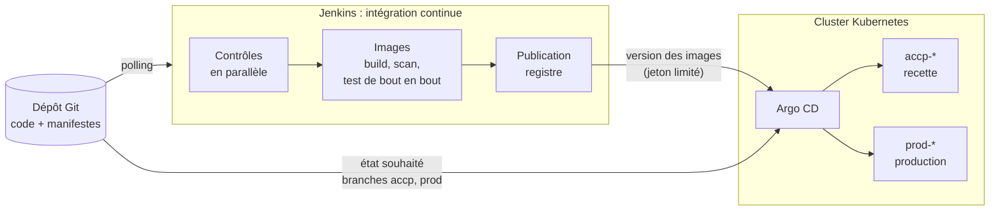

# Démonstration du second outil : Jenkins + Argo CD

> **Story :** US-04.3 · **Jira :** [SCRUM-25](https://maalsi25.atlassian.net/browse/SCRUM-25) · **Epic :** EPIC 04, Comparaison et démonstration de deux solutions CI/CD
> **Responsable :** Membre D · **Binôme :** Membre B
> **Scénario de référence :** [US-04.1](candidats-et-criteres.md) · **Application :** [boutique de démonstration](../../README.md) · **Pipeline :** [`Jenkinsfile`](../../Jenkinsfile) · **Serveur Jenkins :** [`infra/jenkins/`](../../infra/jenkins/) · **Argo CD :** [`infra/argocd/`](../../infra/argocd/)

**But :** montrer une chaîne CI/CD auto-hébergée qui sépare les deux rôles : **Jenkins** fait l'intégration continue (tests, contrôles, images), **Argo CD** fait le déploiement continu en **GitOps**.

---

## 1. Deux outils, deux rôles

| | **Jenkins** : intégration continue | **Argo CD** : déploiement continu (GitOps) |
|---|---|---|
| **Rôle** | Tester, contrôler, construire et publier les images | Faire correspondre en permanence le cluster à l'état décrit dans Git |
| **Où il tourne** | Serveur auto-hébergé (conteneur Docker) | **Dans le cluster Kubernetes**, namespace `argocd` |
| **Ce qu'il lit** | Le code du dépôt (branches `dev`, `accp`, `prod`, `feature/*`) | Les manifestes du dépôt : branche `accp` ou `prod`, surcouche `infra/k8s/overlays/<env>` |
| **Ce qu'il écrit** | Les images, dans le registre | Les ressources Kubernetes de la recette et de la production |
| **Accès au cluster** | **Aucun** : un jeton Argo CD limité au projet `boutique` | Complet, mais **à l'intérieur** du cluster |
| **Configuration** | `infra/jenkins/` (JCasC, Job DSL) | `infra/argocd/` (projet, applications, droits) |

**Modèle « pull » :** le pipeline ne pousse rien dans le cluster. Il indique à Argo CD la **version des images** à déployer, et Argo CD, depuis le cluster, **tire** l'état souhaité depuis Git puis l'applique. C'est l'opposé du modèle « push » de GitHub Actions, où le pipeline applique lui-même les manifestes avec `kubectl` et doit donc détenir les accès au cluster.

---

## 2. Contenu de la démo

| Élément | Fichier | Rôle |
|---|---|---|
| Pipeline | `Jenkinsfile` | **Mêmes étapes et mêmes scripts npm** que GitHub Actions jusqu'à la publication des images. Le déploiement est confié à Argo CD (`npm run deployer:argocd`) |
| Image Jenkins | `infra/jenkins/Dockerfile` + `plugins.txt` | Jenkins LTS (Java 25), client Docker et Docker Compose, Node.js, **CLI Argo CD**. Aucun `kubectl` |
| Configuration Jenkins | `infra/jenkins/casc.yaml` | Compte admin, sécurité et **création automatique du job** multi-branches. Aucun clic de configuration |
| Projet Argo CD | `infra/argocd/projet.yaml` | Sources autorisées : **le seul dépôt du projet**. Destinations autorisées : namespaces `accp-*` et `prod-*` |
| Applications Argo CD | `infra/argocd/applications.yaml` | `boutique-accp` : synchronisation **automatique** et correction des écarts (*selfHeal*). `boutique-prod` : synchronisation **manuelle**, après approbation |
| Droits Argo CD | `infra/argocd/argocd-rbac-cm.yaml` | Compte `jenkins` : consulter, mettre à jour et synchroniser les applications du projet `boutique`, rien d'autre |
| Déploiement | `infra/ci/deployer-argocd.sh` | Transmet la version des images, attend la synchronisation, test de fumée, **retour arrière par l'historique d'Argo CD** en production |

Mise en place : `npm run k8s -- preparer`, `npm run jenkins:demarrer`, `npm run jenkins:connecter`, puis `npm run argocd:installer`. Interfaces : Jenkins sur http://localhost:8090 (`admin` / `admin`), Argo CD par `npm run argocd:ouvrir` sur https://localhost:8443 (mot de passe affiché par l'installation).

---

## 3. Structure de la chaîne

| Concept | Utilisation dans la démo |
|---|---|
| **Pipeline déclaratif** (`Jenkinsfile`) | Le pipeline est du code versionné dans le dépôt |
| **`parallel`** et **`agent { docker { … } }`** | Les 4 contrôles tournent en parallèle, chacun dans un **conteneur jetable** (Maven, Node.js, gitleaks, Semgrep, Trivy) |
| **`input`** | Approbation de la production, réservée à l'utilisateur `admin`, expiration au bout de 30 min |
| **Application Argo CD** | Lien entre un environnement et sa source dans Git (dépôt, branche, chemin de la surcouche Kustomize) |
| **Synchronisation automatique et *selfHeal*** | En recette, tout écart entre le cluster et Git est **corrigé automatiquement** |
| **Historique et retour arrière** | Chaque synchronisation est historisée. En production, un échec du test de fumée déclenche `argocd app rollback` |
| **Paramètre `kustomize.images`** | La version des images (`v-<version>`) est transmise par Jenkins sans modifier Git |

---

## 4. Déroulé de la démonstration (environ 3 min)

| # | Action | Ce que la direction voit |
|---|---|---|
| 1 | Ouvrir le job `petite-maison-boutique`, run `accp` vert lancé avant la soutenance | Contrôles en parallèle, images, puis étape **Recette** qui passe la main à Argo CD |
| 2 | Interface Argo CD, application `boutique-accp` | L'**arbre des ressources** de la recette, synchronisé avec Git, avec la version déployée |
| 3 | **En direct :** supprimer une ressource de la recette (`kubectl -n accp-applicative delete deployment catalogue`) | Argo CD détecte l'écart avec Git et **recrée** la ressource tout seul (*selfHeal*) |
| 4 | `npm run scenario:pipeline-rouge -- secret` → commit | Jenkins **détecte seul** le commit et l'étape secrets passe au **rouge**. Rien n'est construit ni déployé |
| 5 | Build `prod` arrêté sur l'étape **Approbation** → « Mettre en production » | Argo CD synchronise `boutique-prod`. En cas d'échec du test de fumée, **retour arrière** par son historique |

---

## 5. Comportement attendu des scénarios

| Scénario | Ce que montre la chaîne | Ce qui est bloqué |
|---|---|---|
| **Nominal** | Toutes les étapes au vert, puis Argo CD synchronise l'environnement de la branche | Rien |
| **`regression`** (TVA passée à 21 %) | L'étape *Backend* échoue, Jenkins affiche les tests en échec et leur tendance | Images, publication et déploiement : **aucune image défectueuse n'est publiée** |
| **`secret`** (clé d'API commitée) | L'étape *Secrets* échoue, la clé est **masquée dans les journaux** | Aucune image n'est construite ni publiée |
| **Modification manuelle du cluster** | Argo CD signale l'écart (*OutOfSync*) | En recette, l'écart est **corrigé automatiquement**. En production, il reste signalé jusqu'à la prochaine synchronisation approuvée |
| **Échec du test de fumée en production** | Argo CD revient à la synchronisation précédente de son historique | La version défaillante ne reste pas en production |

> **Limite :** un secret commité est **déjà dans l'historique Git**. Le pipeline empêche sa diffusion dans un livrable, mais une vraie clé doit quand même être **révoquée immédiatement**.

---

## 6. Points de friction consignés

| # | Friction rencontrée | Impact | Solution appliquée |
|---|---|---|---|
| 1 | **Mise en place longue** : image Jenkins, plugins, JCasC, Job DSL, **puis** installation et configuration d'Argo CD | Deux outils à installer, configurer et relier | Tout est figé dans `infra/jenkins/` et `infra/argocd/`, et passe par des scripts npm |
| 2 | **Docker dans Jenkins conteneurisé** : les étapes lancent des conteneurs via le **socket Docker de l'hôte** | Le conteneur Jenkins a, de fait, les **droits root sur l'hôte** | Acceptable **uniquement en démo**. En production : agents dédiés et isolés |
| 3 | **Ressources** : Argo CD ajoute ses propres composants au cluster | Le cluster local, dimensionné pour la boutique seule, a saturé sa mémoire | Nœuds portés à 6 Go et 4 processeurs (`infra/k8s/demo.sh`) |
| 4 | **Version des images hors de Git** : Jenkins la transmet en paramètre de l'application Argo CD | L'état déployé n'est pas entièrement décrit par Git | Acceptable pour la démo. En production : *Argo CD Image Updater* avec écriture dans Git, ou commit de la version par le pipeline |
| 5 | **Registre local inaccessible au cluster** | Les images doivent être chargées dans les nœuds | Chargement par le script de déploiement. En production : le cluster tire les images du registre |
| 6 | **Pas de webhook** sans exposer Jenkins sur Internet | Délai de détection jusqu'à 1 min (polling) | Acceptable. Argo CD compare de son côté le cluster à Git toutes les 60 s |
| 7 | **Plugins Jenkins = dette de maintenance** | Mises à jour fréquentes à tester | Versions figées dans l'image, mises à jour planifiées |

---

## 7. Solution de secours de démonstration

| Aléa le jour J | Solution |
|---|---|
| Pas d'Internet | Jenkins tourne en local. **Argo CD lit Git sur GitHub** : sans Internet, montrer l'état déjà synchronisé et la vidéo de secours |
| Jenkins ou Argo CD ne démarre pas | Vidéo d'un run complet + captures de *Stage View* et de l'arbre Argo CD |
| Run trop long en direct | Run vert lancé avant la présentation. En direct, on ne montre que le scénario `secret` et la correction d'écart par Argo CD |

**Checklist de la veille :** `npm run k8s -- preparer`, `npm run jenkins:demarrer`, `npm run jenkins:connecter`, `npm run argocd:installer`, un run `accp` vert, captures d'écran, vidéo d'1 à 2 min.

---

[← Démonstration du premier outil : GitHub Actions](demo-github-actions.md) · [Sommaire](../README.md) · [Conclusion comparative CI/CD →](comparaison-et-choix.md)
