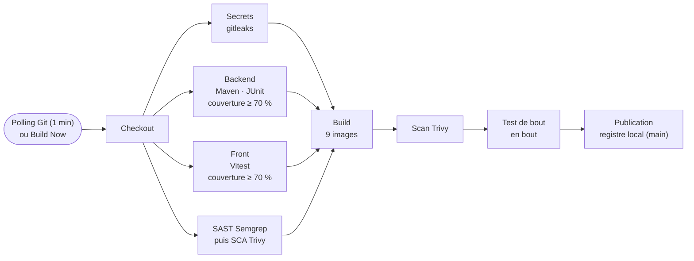

# Démonstration du second outil : Jenkins

> **Story :** US-04.3 · **Jira :** [SCRUM-25](https://maalsi25.atlassian.net/browse/SCRUM-25) · **Epic :** EPIC 04, Comparaison et démonstration de deux solutions CI/CD
> **Responsable :** Membre D · **Binôme :** Membre B
> **Scénario de référence :** [US-04.1](candidats-et-criteres.md) · **Application :** [boutique de démonstration](../../README.md) · **Pipeline :** [`Jenkinsfile`](../../Jenkinsfile) · **Serveur :** [`infra/jenkins/`](../../infra/jenkins/)

---

## 1. Contenu de la démo

| Élément | Fichier | Rôle |
|---|---|---|
| Pipeline | `Jenkinsfile` | **Mêmes étapes et mêmes outils** que le workflow GitHub Actions. Les étapes lourdes appellent les **mêmes scripts** (`infra/ci/`) |
| Image Jenkins | `infra/jenkins/Dockerfile` + `plugins.txt` | Jenkins LTS (Java 25), client Docker **et Docker Compose**, 9 plugins installés au build |
| Configuration du serveur | `infra/jenkins/casc.yaml` | **Jenkins Configuration as Code** : compte admin, sécurité, et **création automatique du job** (Job DSL). Aucun clic de configuration |
| Lancement | `infra/jenkins/docker-compose.yml` | Jenkins (port 8090) + **registre d'images local** (équivalent de GHCR) |

Lancement : `cd infra/jenkins && docker compose up -d --build`, puis http://localhost:8090 (`admin` / `admin`). Voir le [README du dépôt](../../README.md), section 4.

---

## 2. Structure du pipeline

| Concept Jenkins | Utilisation dans la démo |
|---|---|
| **Pipeline déclaratif** (`Jenkinsfile`) | Le pipeline est du code versionné dans le dépôt, comme `ci.yml` |
| **`parallel`** | Les 4 contrôles de qualité tournent en parallèle sur le même serveur |
| **`agent { docker { … } }`** | Chaque contrôle tourne dans un **conteneur jetable** (Maven, Node.js, gitleaks, Semgrep, Trivy), ce qui évite d'installer des outils sur le serveur |
| **`post { always { junit … } }`** | Les résultats des tests backend sont **historisés** et affichés en graphe par Jenkins |
| **`when { expression … }`** | Publication uniquement sur la branche `main` |
| **`options`** | Horodatage des logs, pas de builds concurrents, timeout de 40 min, rotation des 20 derniers builds |
| **Polling SCM** | Jenkins interroge le dépôt chaque minute. Un webhook est possible si Jenkins est joignable depuis la forge |

---

## 3. Déroulé de la démonstration (environ 3 min)

| # | Action | Ce que la direction voit |
|---|---|---|
| 1 | Montrer `casc.yaml` et `Jenkinsfile` | Le **serveur et le pipeline sont du code** : on peut recréer Jenkins à l'identique |
| 2 | Ouvrir le job `petite-maison-boutique`, run vert lancé avant la soutenance | **Étapes, branche parallèle, durées** (*Stage View* / *Pipeline Overview*) |
| 3 | *Test Result* | **23 tests backend**, historique et tendance |
| 4 | `curl localhost:5000/v2/_catalog` | **Résultat** : les 9 images `build-N` sont publiées |
| 5 | `sh tools/demo/scenario.sh secret` → commit | Jenkins **détecte seul** le commit (polling) et l'étape secrets passe au **rouge**. Build et publication sont **sautés** |

---

## 4. Résultats de l'exécution réelle (27/11/2026, poste Windows 11 + Docker Desktop)

Le dépôt de la boutique a été copié dans un dépôt Git autonome, monté dans Jenkins.

### Build #1 : pipeline vert

| Étape | Statut | Durée |
|---|---|---|
| Checkout | OK | 1 s |
| Secrets (gitleaks) | OK | 4 s |
| Backend : 22 tests, couverture ≥ 60 % par service *(seuil relevé à 70 % ensuite, avec un 23e test, pour suivre US-02.1)* | OK | 77 s |
| Front : 10 tests, couverture 80 % | OK | 16 s |
| SAST (Semgrep) puis SCA (Trivy) | OK | 6 s + 24 s |
| Build des 9 images | OK | 28 s *(couches déjà en cache sur le poste)* |
| Scan des 9 images (Trivy) | OK | 48 s |
| Test de bout en bout (boutique complète, parcours client) | OK | 42 s |
| Publication (registre local → `build-1`) | OK | 3 s |
| **Total** | **SUCCESS** | **3 min 24 s** |

*Les étapes parallèles se chevauchent : la phase de qualité dure environ 77 s, celle de la branche la plus lente (backend).*

### Build #2 : scénario `regression` (TVA passée à 21 %)

- **Déclenchement :** automatique, *« Started by an SCM change »*. Le commit a été détecté par le polling sans aucune action manuelle.
- **Résultat :** **FAILURE en 37 s.** L'étape *Backend* échoue : dans le service catalogue, **2 tests sur 7 en échec** (prix TTC du produit, calcul de TVA). Jenkins affiche les tests en échec et la tendance par rapport au build précédent.
- **Quality gate :** build des images, scan, test de bout en bout et publication **non exécutés**. **Aucune image défectueuse n'est publiée.**
- Les autres branches parallèles (secrets, front, SAST/SCA) vont à leur terme : le développeur reçoit **tous les retours en un seul run**.

### Build #3 : scénario `secret` (clé d'API du prestataire de paiement commitée)

- **Déclenchement :** automatique (polling).
- **Résultat :** **FAILURE.** L'étape *Secrets (gitleaks)* échoue **en 8 s** (`leaks found: 1`, clé **masquée dans les logs** grâce à `--redact`). Le run se termine en 53 s, le temps que les autres branches parallèles aillent au bout.
- **Constat :** aucune image n'est construite ni publiée.
- **Limite :** le secret est **déjà dans l'historique Git**. Le pipeline empêche sa diffusion dans un livrable, mais une vraie clé devrait quand même être **révoquée immédiatement**. D'où l'intérêt de détecter **avant le commit** (hook local) ou **avant le push** (*push protection* de GitHub).

### Synthèse

| Build | Scénario | Déclenchement | Résultat | Durée |
|---|---|---|---|---|
| #1 | Nominal | Commit initial (polling) | SUCCESS, 9 images `build-1` publiées | 3 min 24 s |
| #2 | `regression` | Commit (polling) | Tests du catalogue (2/7 en échec), livraison bloquée | 37 s |
| #3 | `secret` | Commit (polling) | gitleaks en 8 s, livraison bloquée | 53 s |

> L'exécution précédente sur le mini-service Flask (03/11/2026, 64 s) n'est plus représentative : la boutique compte 9 images et un test de bout en bout de toute l'application.

---

## 5. Points de friction consignés

| # | Friction rencontrée | Impact | Solution appliquée |
|---|---|---|---|
| 1 | **Mise en place longue** : image personnalisée, choix des plugins, configuration JCasC, Job DSL | Environ 1 à 2 h la première fois, contre environ 15 min pour GitHub Actions | Tout est figé dans `infra/jenkins/` : la suivante prend 5 min |
| 2 | **Docker dans Jenkins conteneurisé** : les étapes lancent des conteneurs via le **socket Docker de l'hôte** | Le conteneur Jenkins a, de fait, les **droits root sur l'hôte** (démo lancée en `user: root`). Et un fichier du workspace **ne peut pas être monté** dans un conteneur (le chemin n'existe pas sur l'hôte) | Acceptable **uniquement en démo**. Configurations Kong et PostgreSQL intégrées aux images, exceptions de scan transmises par l'entrée standard. En production : agents dédiés et isolés |
| 3 | **Protection CSRF** : déclencher un build par API exige un jeton *crumb* | Script d'automatisation un peu plus complexe | Récupération du crumb avant l'appel |
| 4 | **Checkout d'un dépôt local** bloqué par défaut (sécurité du plugin Git) | Démo hors-ligne impossible sans option | Option `ALLOW_LOCAL_CHECKOUT` activée **pour la démo uniquement** |
| 5 | **Premier build lent** (téléchargement des images Maven, Node.js, gitleaks, Semgrep, Trivy, de la base de vulnérabilités et des dépendances) | Risque le jour J | Volumes de cache Maven et Trivy + **build de préchauffage la veille** |
| 8 | **Conflit de port** : la passerelle de la boutique occupe déjà le port 8080 | Jenkins ne démarre pas à côté de la boutique | Jenkins publié sur le port **8090** |
| 6 | **Pas de webhook** sans exposer Jenkins sur Internet | Délai de détection jusqu'à 1 min (polling) | Acceptable. En production : webhook via un reverse proxy sécurisé |
| 7 | **Plugins = dette de maintenance** (9 plugins et leurs dépendances, qui reçoivent des alertes de sécurité régulières) | Mises à jour fréquentes à tester | Versions figées dans l'image, mises à jour planifiées |

---

## 6. Solution de secours de démonstration

| Aléa le jour J | Solution |
|---|---|
| Pas d'Internet | Jenkins tourne **entièrement en local** (images téléchargées la veille, dépôt monté en local) : c'est la **démo de secours de l'EPIC** |
| Jenkins ne démarre pas | Vidéo d'un run complet + captures de *Stage View* et des résultats de tests |
| Run trop long en direct | Build vert lancé avant la présentation. En direct, on ne montre que le scénario rouge `secret` (gitleaks échoue en 8 s) |

**Checklist de la veille :** `docker compose up -d --build`, un build complet vert, captures d'écran, vidéo d'1 à 2 min, puis `docker compose stop` (sans `-v`, pour garder le cache).

---

[← Démonstration du premier outil : GitHub Actions](demo-github-actions.md) · [Sommaire](../README.md) · [Conclusion comparative CI/CD →](comparaison-et-choix.md)
