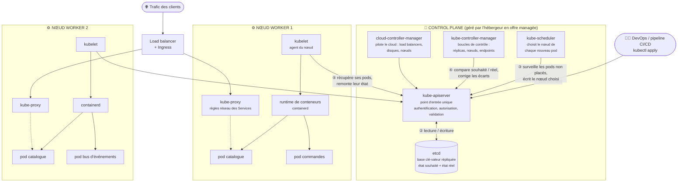

# US-06.1 — Architecture de l'orchestrateur (Kubernetes)

> **Jira :** [SCRUM-31](https://maalsi25.atlassian.net/browse/SCRUM-31) · **Epic :** EPIC 06, Environnement managé et stratégie de tests
> **Responsable :** Membre D · **Binôme :** Membre B
> **Entrées :** [US-03.2, architecture](../architecture/US-03.2_architecture_macroscopique.md) · [US-02.2, cycle DevSecOps](../qualite_devsecops/US-02.2_cycle_devsecops.md) · **Démo :** [`demos/kubernetes/`](../../demos/kubernetes/)

**But :** expliquer à la direction **comment l'environnement managé exécute la plateforme**, quels sont ses composants internes, et pourquoi il répond aux exigences de disponibilité et de scalabilité.

---

## 1. Pourquoi un orchestrateur, et pourquoi Kubernetes

| Besoin (US-02.1 / US-03.2) | Réponse d'un orchestrateur |
|---|---|
| Chaque composant **redondé** (au moins 2 instances) | Il maintient en permanence le nombre d'instances demandé |
| **Pics** de charge (festival, fanzine, exclusivités) | Il ajoute ou retire des instances automatiquement |
| **Isolation des pannes** entre composants | Chaque service tourne dans ses propres conteneurs, avec des ressources limitées |
| **Déploiement sans coupure**, rollback | Mises à jour progressives et retour arrière intégrés |
| **Petite équipe** (C-11) | Configuration **déclarative** et versionnée : on décrit l'état voulu, l'orchestrateur s'en charge |

**Kubernetes** est retenu, car c'est le **standard du marché**. Il est proposé **en service managé** par la plupart des hébergeurs européens, ce qui respecte C-04. L'image de conteneur produite par le pipeline CI/CD (EPIC 04) y est déployée telle quelle.

---

## 2. Schéma de l'architecture interne

> Schéma original réalisé par le groupe. Le source Mermaid ci-dessous sert de référence et est redessiné dans le support PPT.

### Lecture du schéma

- **Tous les composants passent par l'API server.** Aucun ne parle directement à etcd ni aux autres composants. C'est le point unique de contrôle d'accès et d'audit.
- **Le control plane décide, les nœuds exécutent.** En offre managée, l'hébergeur exploite le control plane (haute disponibilité, sauvegarde d'etcd, mises à jour). L'équipe ne gère que les nœuds et les applications.
- **Le modèle est déclaratif.** On ne dit pas « démarre un conteneur » mais « je veux 2 instances du catalogue ». Les contrôleurs rapprochent sans cesse l'état réel de l'état souhaité.

---

## 3. Rôle de chaque composant

### Control plane

| Composant | Rôle | Si le composant tombe… |
|---|---|---|
| **kube-apiserver** | Porte d'entrée unique (API REST). Authentifie, autorise (RBAC), valide et enregistre chaque demande. Tous les autres composants le surveillent | Plus aucune modification possible. **Les applications continuent de tourner** |
| **etcd** | Base de données clé-valeur **répliquée** (consensus Raft, 3 ou 5 membres). Contient **tout l'état du cluster** : objets, configurations, secrets | Perte du cluster si non sauvegardée : **la sauvegarde d'etcd est critique**. Elle est chiffrée, car elle contient les secrets |
| **kube-scheduler** | Choisit le **nœud** de chaque nouveau pod selon les ressources demandées, les contraintes (répartition sur plusieurs nœuds ou zones) et les affinités | Les nouveaux pods restent en attente. Les pods existants ne sont pas affectés |
| **kube-controller-manager** | Exécute les **boucles de contrôle** : ReplicaSet (nombre d'instances), Deployment (mises à jour progressives), Node (détection des nœuds morts), Job, Endpoints… | Plus d'auto-réparation ni de mise à l'échelle |
| **cloud-controller-manager** | Fait le lien avec l'hébergeur : crée les **load balancers**, attache les **disques**, gère les machines | Plus de nouveaux load balancers ni de nouveaux disques |

### Nœuds (workers)

| Composant | Rôle |
|---|---|
| **kubelet** | Agent présent sur chaque nœud. Récupère auprès de l'API server les pods qui lui sont attribués, les fait démarrer par le runtime, exécute les **sondes de santé** et remonte l'état |
| **kube-proxy** | Programme les règles réseau du nœud pour qu'un **Service** (adresse stable) répartisse le trafic entre les pods sains |
| **Runtime de conteneurs** | Exécute les conteneurs (containerd). Télécharge les images depuis le registre privé |
| **Pod** | Plus petite unité déployable : un ou plusieurs conteneurs partageant le réseau. **Éphémère** : il peut être recréé ailleurs à tout moment |

### Modules complémentaires indispensables

| Module | Rôle pour la plateforme |
|---|---|
| **CoreDNS** | Résolution de noms interne (`catalogue.zone-applicative`) |
| **Plugin réseau (CNI)** | Réseau entre pods. Applique les **NetworkPolicy** (zones de sécurité de US-03.2) |
| **Ingress controller** | Point d'entrée HTTP(S) : correspond à la passerelle EN-2 |
| **metrics-server + HPA** | Mesure le CPU et la mémoire, et ajuste le nombre d'instances |

---

## 4. Ce qui se passe lors d'un déploiement (vérifié en démo)

| # | Étape | Composant | Observé dans la démo |
|---|---|---|---|
| 1 | Le pipeline envoie `catalogue.yaml` (2 instances) | API server → etcd | `deployment.apps/catalogue created` |
| 2 | Le contrôleur Deployment crée un ReplicaSet, qui crée 2 pods « non placés » | controller-manager | — |
| 3 | Le scheduler attribue un nœud à chaque pod, de préférence des nœuds différents | scheduler | 1 pod sur `petite-maison`, 1 sur `petite-maison-m02` |
| 4 | Le kubelet de chaque nœud fait démarrer le conteneur, puis exécute les sondes | kubelet + containerd | `Readiness probe failed` puis `Running 1/1` |
| 5 | Le Service ne route que vers les pods prêts | kube-proxy | Réponse JSON du catalogue depuis la zone applicative |
| 6 | **Panne simulée** : un pod est supprimé | controller-manager | Nouveau pod créé, **service rétabli en 7 s** |
| 7 | **Mise à jour progressive** sur 4 instances | controller-manager | Terminée en 29 s, **sans coupure** (`maxUnavailable: 0`) |
| 8 | **Cloisonnement** : appel depuis un autre namespace | plugin réseau (CNI) | Bloqué par la NetworkPolicy (aucune réponse), alors que l'appel depuis la zone applicative aboutit |

---

## 5. Correspondance avec l'architecture de la plateforme

| Exigence | Mécanisme Kubernetes | Dans `catalogue.yaml` |
|---|---|---|
| Redondance (US-03.2 §4) | `replicas` ≥ 2 + répartition sur plusieurs nœuds | `replicas: 2`, `topologySpreadConstraints` |
| Scalabilité (pics) | **HorizontalPodAutoscaler** | De 2 à 6 instances à 70 % de CPU |
| Disponibilité pendant la maintenance | **PodDisruptionBudget** | `minAvailable: 1` |
| Mise à jour sans coupure / rollback | Deployment `RollingUpdate`, `kubectl rollout undo` | `maxUnavailable: 0` |
| Zones de sécurité (US-03.2) | **Namespaces** + **NetworkPolicy** | Namespace `zone-applicative` |
| Moindre privilège | `securityContext`, RBAC, pas de jeton de service | Non-root, système de fichiers en lecture seule, `drop: ALL` |
| Secrets (TR-4) | Secrets chiffrés dans etcd, ou coffre-fort externe injecté | — (pas de secret dans la démo) |
| Isolation des pannes | `requests` / `limits` par conteneur | 100m-500m de CPU, 96-192 Mio |

**Découpage en namespaces proposé :** `zone-publique` (UI), `zone-applicative` (passerelle, services métier), `zone-donnees` (bases, si elles ne sont pas en service managé), `zone-integration` (IN-x), `observabilite`.

**Recommandation d'exploitation :** Kubernetes **managé** chez un hébergeur européen. Les bases de données et le bus d'événements sont pris de préférence **en service managé**, hors du cluster, pour que la petite équipe n'ait à exploiter que des services sans état.
