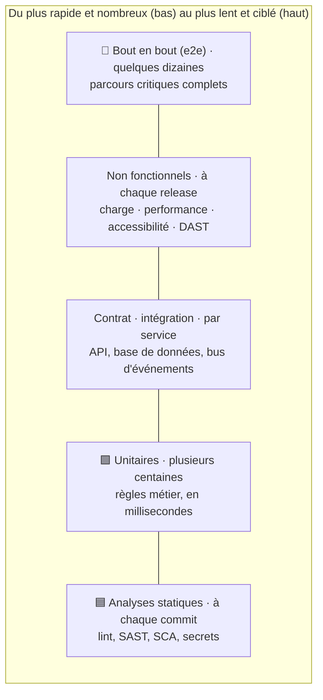

# US-06.2 — Catégories de tests

> **Jira :** [SCRUM-32](https://maalsi25.atlassian.net/browse/SCRUM-32) · **Epic :** EPIC 06, Environnement managé et stratégie de tests
> **Responsable :** Membre D · **Binôme :** Membre B
> **Entrées :** [US-02.1, attributs de qualité](../qualite_devsecops/US-02.1_attributs_qualite.md) (seuils de vérification) · [US-02.2, cycle DevSecOps](../qualite_devsecops/US-02.2_cycle_devsecops.md)

**But :** définir **quels tests** vérifient **quels attributs de qualité**, contre **quels risques** du projet, et **à partir de quand** un test bloque la livraison.

---

## 1. La pyramide de tests retenue

**Principe :** plus un test est bas dans la pyramide, plus il est **rapide, stable et nombreux**. On détecte au plus tôt (*shift-left*) et on garde les tests lents pour ce que les tests rapides ne peuvent pas prouver.

---

## 2. Catégories de tests

### 2.1 Tests unitaires

| | |
|---|---|
| **Objectif** | Vérifier une règle métier isolée : calcul de TVA (FR / UK), application d'un code promo, validité d'une annonce de troc, droits d'accès à un numéro du fanzine |
| **Risques couverts** | Erreur de prix ou de taxe (perte financière, litige), régression lors d'une évolution par un junior |
| **Attributs** | Maintenabilité (testabilité), fiabilité |
| **Critère de passage** | 100 % des tests réussis **et** couverture ≥ **70 %** sur le code métier (US-02.1 §2.6) |
| **En cas d'échec** | 🛑 **Bloquant** : la fusion est refusée |

### 2.2 Tests d'intégration

| | |
|---|---|
| **Objectif** | Vérifier qu'un service fonctionne **avec ses dépendances réelles** : sa base de données, le bus d'événements (publication / consommation, DLQ), le connecteur SI |
| **Risques couverts** | Requête incorrecte, événement mal formé, message perdu entre deux services, régression de la synchronisation des stocks (survente) |
| **Attributs** | Fiabilité, interopérabilité |
| **Critère de passage** | 100 % réussis, dépendances lancées dans des conteneurs éphémères (comme le scénario de [US-05.2](../technologies/US-05.2_demo_rabbitmq.md)) |
| **En cas d'échec** | 🛑 Bloquant |

### 2.3 Tests de contrat

| | |
|---|---|
| **Objectif** | Vérifier qu'un service respecte l'**interface promise** à ses consommateurs : API documentées (OpenAPI), **schémas d'événements** versionnés |
| **Risques couverts** | Un service modifie un champ et casse les autres sans s'en rendre compte. Risque fort avec un découpage en services et une petite équipe |
| **Attributs** | Interopérabilité, maintenabilité |
| **Critère de passage** | Aucune modification incompatible sans nouvelle version de l'interface |
| **En cas d'échec** | 🛑 Bloquant |

### 2.4 Tests de bout en bout (e2e)

| | |
|---|---|
| **Objectif** | Rejouer les **parcours critiques** dans un navigateur, sur l'environnement d'intégration : achat d'un produit, abonnement au fanzine, lecture dans la liseuse, publication d'une annonce de troc, envoi d'un message |
| **Risques couverts** | Parcours d'achat cassé (perte directe de chiffre d'affaires) alors que chaque service, isolément, fonctionne |
| **Attributs** | Fiabilité, utilisabilité |
| **Critère de passage** | 100 % des parcours critiques réussis. Les tests instables sont mis en quarantaine et corrigés sous 48 h |
| **En cas d'échec** | 🛑 Bloque la promotion vers le staging |

### 2.5 Tests de performance

| | |
|---|---|
| **Objectif** | Mesurer les **temps de réponse** sous une charge **normale** |
| **Risques couverts** | Dégradation progressive, avec une baisse de conversion liée à la lenteur (C-02) |
| **Attributs** | Performance |
| **Critère de passage** | p95 des API < **300 ms**, LCP < **2,5 s**, chat < **1 s** (US-02.1 §2.3). Écart de plus de 10 % par rapport à la version précédente = alerte |
| **En cas d'échec** | 🛑 Bloque la mise en production si le seuil est dépassé. ⚠️ Alerte en cas de simple régression |

### 2.6 Tests de charge et de montée en charge

| | |
|---|---|
| **Objectif** | Simuler un **pic** (festival, exclusivité Evil Ed) à **10 fois le trafic moyen**, puis un **test d'endurance** de plusieurs heures |
| **Risques couverts** | Site indisponible pendant le pic, survente lors d'une ruée sur une édition limitée, fuite mémoire |
| **Attributs** | Scalabilité, disponibilité |
| **Critère de passage** | Seuils de performance tenus à ×10, **mise à l'échelle automatique déclenchée** (HPA, cf. [US-06.1](US-06.1_architecture_orchestrateur.md)), **0 survente**, retour à la normale après le pic |
| **En cas d'échec** | 🛑 Bloque la release majeure. Test **obligatoire** avant chaque événement à pic connu |

### 2.7 Tests d'accessibilité

| | |
|---|---|
| **Objectif** | Vérifier la conformité **RGAA** : audit automatique de chaque page modifiée et audit manuel (lecteur d'écran, navigation au clavier) des parcours critiques |
| **Risques couverts** | Non-conformité légale (European Accessibility Act), exclusion d'utilisateurs, liseuse inutilisable au lecteur d'écran |
| **Attributs** | Accessibilité |
| **Critère de passage** | **0 erreur bloquante** à l'audit automatique. Audit manuel ≥ **75 %** de conformité en V1 |
| **En cas d'échec** | 🛑 Erreur automatique bloquante. ⚠️ Non-conformité manuelle transformée en story priorisée |

### 2.8 Tests de sécurité

| Type | Objectif | Critère | En cas d'échec |
|---|---|---|---|
| **Secrets** | Aucun mot de passe ni jeton dans le code | 0 secret | 🛑 Bloquant |
| **SAST** | Failles dans le code source (injections, XSS…) | 0 alerte de sévérité haute | 🛑 Bloquant |
| **SCA** | Dépendances vulnérables | 0 CVE critique ou haute corrigeable | 🛑 Bloquant |
| **Scan d'image et d'IaC** | OS de l'image, mauvaise configuration (conteneur root, port ouvert) | 0 critique | 🛑 Bloquant |
| **DAST** | Attaque de l'application déployée (OWASP Top 10, en-têtes) | 0 alerte haute | 🛑 Bloque le staging |
| **Test d'intrusion** | Audit manuel par un tiers | Constats critiques corrigés | 🛑 Bloque la première mise en production |

*Le détail des scans et du traitement des constats est dans [US-07.2](../securite/US-07.2_controles_scans.md).*

### 2.9 Tests de résilience et de restauration

| | |
|---|---|
| **Objectif** | Vérifier que la plateforme **survit à une panne** : arrêt d'une instance, d'un nœud, d'un consommateur d'événements. Vérifier que la **restauration des sauvegardes** fonctionne |
| **Risques couverts** | Indisponibilité prolongée, perte de commandes, sauvegardes inutilisables le jour où on en a besoin |
| **Attributs** | Disponibilité (tolérance aux pannes, récupérabilité) |
| **Critère de passage** | Service rétabli automatiquement (démontré : 7 s pour une instance, cf. US-06.1). Restauration mensuelle réussie, **RPO ≤ 1 h, RTO ≤ 4 h** |
| **En cas d'échec** | ⚠️ Incident de priorité haute, inscrit au backlog |

### 2.10 Tests de fumée (smoke tests)

| | |
|---|---|
| **Objectif** | Vérifier en quelques secondes qu'un déploiement **démarre et répond** (`/health`, une page clé) |
| **Risques couverts** | Image défectueuse, configuration d'environnement erronée |
| **Critère de passage** | Réponses attendues en moins de 30 s |
| **En cas d'échec** | 🛑 **Rollback automatique** |

---

## 3. Synthèse : attributs de qualité couverts

| Attribut (US-02.1) | Tests qui le vérifient |
|---|---|
| 🔴 Sécurité | Secrets, SAST, SCA, scan d'image, DAST, test d'intrusion |
| 🔴 Fiabilité / disponibilité | Unitaires, intégration, e2e, résilience, smoke |
| 🟠 Performance | Performance, charge |
| 🟠 Scalabilité | Charge (×10), endurance |
| 🟠 Accessibilité | Audit automatique, audit manuel RGAA |
| 🟢 Maintenabilité | Unitaires + couverture, analyse statique, contrat |
| 🟢 Interopérabilité | Intégration, contrat |

Chaque attribut est couvert par **au moins deux** types de tests, dont au moins un **automatisé dans le pipeline**.
