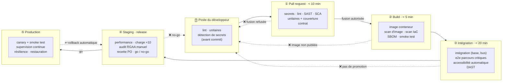

# US-06.3 — Positionnement des tests dans le pipeline CI/CD

> **Jira :** [SCRUM-33](https://maalsi25.atlassian.net/browse/SCRUM-33) · **Epic :** EPIC 06, Environnement managé et stratégie de tests
> **Responsable :** Membre D · **Binôme :** Membre B
> **Entrées :** [US-06.2, catégories de tests](US-06.2_categories_tests.md) · [US-04.4, choix CI/CD](../cicd/US-04.4_conclusion_comparative.md) · [US-02.2, cycle DevSecOps](../qualite_devsecops/US-02.2_cycle_devsecops.md)

**But :** placer chaque famille de tests **à l'étape du pipeline où elle est la plus utile**, et rendre explicites les **conséquences d'un échec**. Le focus est la **stratégie**, pas le catalogue d'outils.

---

## 1. Schéma du pipeline et des tests

> Schéma original réalisé par le groupe. Le source Mermaid ci-dessous sert de référence et est redessiné dans le support PPT.

**Logique :** les tests **rapides et nombreux** sont exécutés **à chaque modification**. Les tests **lents et coûteux** sont exécutés **moins souvent**, sur un environnement proche de la production. Un défaut est arrêté **le plus tôt possible**, quand sa correction coûte le moins.

---

## 2. Tableau de positionnement

| Étape | Déclencheur | Tests exécutés | Durée cible | Si un test échoue… | Qui est alerté |
|---|---|---|---|---|---|
| **⓪ Poste** | Avant chaque commit (hook) | Lint, unitaires du module modifié, détection de secrets | Secondes | Le commit est refusé localement | Le développeur |
| **① Pull request** | Chaque PR | Secrets, lint, **SAST**, **SCA**, **unitaires + couverture**, **contrat** | < 10 min | 🛑 **La fusion est impossible** (statut rouge sur la PR) | Auteur de la PR |
| **② Build** | Fusion sur `main` | Build de l'image, **scan d'image et d'IaC**, SBOM, **smoke test** de l'image | < 5 min | 🛑 L'image **n'est pas publiée** dans le registre | Auteur + DevOps |
| **③ Intégration** | Chaque image publiée | **Intégration** (base, bus d'événements, connecteur SI), **e2e** des parcours critiques, **accessibilité automatique**, **DAST** | < 20 min | 🛑 **Pas de promotion** vers le staging | Équipe (canal `#ci`) |
| **④ Staging** | Release candidate (hebdomadaire) et **avant chaque pic connu** | **Performance**, **charge ×10** et endurance, **audit RGAA manuel** (échantillon), recette fonctionnelle | Heures | 🛑 **No-go** : la release est reportée | PO + équipe |
| **⑤ Production** | Après go du PO | Déploiement **canary** + **smoke test**, puis supervision. Résilience et restauration **planifiées** (mensuelles) | Minutes, puis continu | ↩️ **Rollback automatique** si le smoke test échoue ou si le taux d'erreur augmente | DevOps d'astreinte |

---

## 3. Lien entre les tests et les exigences de qualité

| Exigence (US-02.1) | Seuil | Étape du pipeline qui le vérifie |
|---|---|---|
| 0 vulnérabilité critique ou haute | SAST, SCA, scan d'image, DAST | ①, ②, ③ |
| Couverture ≥ 70 % du code métier | Unitaires | ① |
| p95 des API < 300 ms, LCP < 2,5 s | Performance | ④ |
| ×10 le trafic moyen sans dégradation | Charge | ④ (et avant chaque pic) |
| 0 erreur d'accessibilité bloquante | Accessibilité automatique | ③ |
| ≥ 75 % de conformité RGAA | Audit manuel | ④ |
| Disponibilité 99,5 %, RTO ≤ 4 h | Smoke, canary, résilience, restauration | ⑤ |
| Stocks synchronisés en moins de 5 min | Intégration (connecteur SI) | ③ |

---

## 4. Ce qui est déjà démontré

Le pipeline de démonstration de l'EPIC 04 ([`demos/cicd/`](../../demos/cicd/)) implémente déjà les étapes **① et ②**, à l'identique sur GitHub Actions et Jenkins :

| Étape | Tests de la démo | Démontré |
|---|---|---|
| ① | Secrets (gitleaks), lint (ruff), SAST (bandit), SCA (pip-audit), unitaires + couverture ≥ 80 % (pytest) | ✅ Scénario `regression` : 2 tests rouges, **build non lancé** (22 s) |
| ① | Secrets | ✅ Scénario `secret` : faux jeton détecté, **livraison bloquée** |
| ② | Scan d'image (trivy), smoke test | ✅ |
| ⑤ | Sondes de santé et auto-réparation | ✅ Démo Kubernetes ([US-06.1](US-06.1_architecture_orchestrateur.md)) |

---

## 5. Règles de gouvernance des tests

- **Un test bloquant ne se contourne pas.** Toute exception (faux positif SAST, CVE sans correctif) est **documentée**, validée par le Security Champion, et a une **date d'expiration**.
- **Les tests instables** (*flaky*) sont mis en quarantaine **et** une story de correction est créée : un pipeline auquel on ne croit plus n'arrête plus rien.
- **Les seuils évoluent** à chaque rétrospective, en fonction des incidents de production (boucle d'amélioration continue, [US-07.4](../securite/US-07.4_amelioration_continue.md)).
- **Durée totale ① + ② inférieure à 15 min**, sinon les développeurs contournent le pipeline. Les tests lents sont déplacés vers ③ ou ④.
