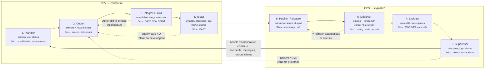

# US-02.2 — Cycle de vie DevSecOps

> **Jira :** [SCRUM-18](https://maalsi25.atlassian.net/browse/SCRUM-18) · **Epic :** EPIC 02, Qualité logicielle et démarche DevSecOps
> **Responsable :** Membre B · **Binôme :** Membre D
> **Entrées :** [US-02.1, attributs de qualité](US-02.1_attributs_qualite.md) · [US-01.1, synthèse du besoin](../cadrage/US-01.1_synthese_besoin.md)

**But :** montrer comment l'équipe livre **en continu** une application de qualité en intégrant la **sécurité à chaque étape** (*shift-left*), et non seulement à la fin.

---

## 1. Principes

| Principe | Signification pour le projet |
|---|---|
| **Shift-left** | Les contrôles (tests, sécurité, accessibilité) ont lieu **le plus tôt possible**, quand une correction coûte le moins cher |
| **Tout est automatisé** | Une petite équipe ne peut pas tout vérifier à la main : le pipeline CI/CD est le garde-fou |
| **Tout est code** | Application, infrastructure, configuration et règles de sécurité sont versionnées dans Git, relues et rejouables |
| **Quality gates** | Un livrable ne passe à l'étape suivante que s'il respecte les seuils définis (US-02.1). Sinon, le pipeline s'arrête |
| **Boucles de retour** | La production renvoie des informations (métriques, incidents, retours clients) qui alimentent la planification suivante |
| **Responsabilité partagée** | La sécurité est l'affaire de tous, pas d'une équipe isolée en bout de chaîne |

---

## 2. Schéma du cycle

> Schéma original réalisé par le groupe. Le source Mermaid ci-dessous sert de référence et est redessiné dans le support PPT.

### Lecture du schéma

- **Flèches pleines :** le flux normal d'une fonctionnalité, de l'idée à la production.
- **Grande boucle (Superviser → Planifier) :** l'**amélioration continue**. Ce qu'on observe en production devient du travail planifié.
- **Flèches en pointillé :** les **boucles de retour courtes**. Un problème détecté arrête le flux et renvoie au bon endroit.
- **« Sécu : »** les **contrôles de sécurité** intégrés à chaque étape.

---

## 3. Rôle de chaque étape

### 1. Planifier

| | |
|---|---|
| **Rôle** | Transformer les besoins (F-xx) et les retours de production en user stories priorisées, avec des critères d'acceptation **incluant la qualité** (performance, accessibilité, sécurité) |
| **Sécurité** | **Modélisation des menaces** sur les fonctionnalités sensibles (paiement, chat, troc, espace utilisateur) : qui peut attaquer, comment, avec quel impact. Exigences de sécurité et RGPD ajoutées aux stories |
| **Sortie** | Backlog priorisé, *Definition of Done* incluant les contrôles qualité |

### 2. Coder

| | |
|---|---|
| **Rôle** | Développer sur une **branche dédiée**, avec des tests écrits en même temps que le code |
| **Sécurité** | Règles de codage sécurisé (OWASP Top 10), **détection de secrets** avant chaque commit, lint et analyse dans l'IDE, **revue de code obligatoire** par un pair |
| **Sortie** | Pull/merge request relue et approuvée |

### 3. Intégrer / Build (intégration continue)

| | |
|---|---|
| **Rôle** | À chaque fusion, le pipeline **compile, assemble et empaquette** automatiquement l'application (image conteneur). On détecte immédiatement les conflits d'intégration |
| **Sécurité** | **SAST** (analyse statique du code source), **SCA** (vulnérabilités des dépendances open source), génération d'un **SBOM** (inventaire des composants, utile pour l'EPIC 07) |
| **Quality gate** | Build bloqué si : compilation en échec, vulnérabilité critique ou haute, qualité de code sous le seuil |

### 4. Tester

| | |
|---|---|
| **Rôle** | Vérifier automatiquement que l'application **fait ce qu'on attend** et respecte les attributs de qualité |
| **Contenu** | Tests unitaires → intégration → bout en bout (parcours d'achat, abonnement, troc) → **accessibilité RGAA automatisée** → **performance et charge** (avant les releases majeures et les pics) |
| **Sécurité** | **DAST** : scan dynamique de l'application déployée en environnement de test (injections, XSS, en-têtes de sécurité) |
| **Quality gate** | Tous les tests passent, couverture ≥ seuil, aucune erreur d'accessibilité bloquante, temps de réponse dans les objectifs |
| *Détail* | *Le placement précis de chaque type de test dans le pipeline est traité en US-06.3* |

### 5. Publier (Release)

| | |
|---|---|
| **Rôle** | Produire un **artefact versionné, immuable** (image avec numéro de version) qui sera déployé **à l'identique** dans tous les environnements |
| **Sécurité** | **Scan de l'image** conteneur (OS, bibliothèques), **signature** de l'artefact pour garantir son origine, scan de l'**infrastructure as code** (mauvaises configurations) |
| **Sortie** | Artefact stocké dans un registre privé, avec ses notes de version |

### 6. Déployer (livraison et déploiement continus)

| | |
|---|---|
| **Rôle** | Déployer automatiquement en **staging** (copie de la production), puis en **production** après validation |
| **Stratégie** | **Canary** ou **blue-green** : la nouvelle version reçoit d'abord une petite partie du trafic. **Rollback automatique** si le taux d'erreur augmente. **Gel des déploiements** pendant les pics (festival, sortie d'une exclusivité) |
| **Sécurité** | Secrets injectés depuis un coffre-fort (jamais dans le code), configuration durcie, principe du **moindre privilège**. Infrastructure hébergée **en Europe** (C-04) |
| **Validation** | Les déploiements en production sont validés par le **Product Owner** pour les fonctionnalités visibles |

### 7. Exploiter

| | |
|---|---|
| **Rôle** | Faire tourner la plateforme au quotidien : **mise à l'échelle automatique** lors des pics, sauvegardes, application des correctifs |
| **Sécurité** | **WAF** (pare-feu applicatif) et protection anti-DDoS en entrée, **MFA** pour les accès d'administration, application régulière des **correctifs de sécurité**, gestion des accès |
| **Sortie** | Service disponible conformément aux objectifs (99,5 %, RPO/RTO) |

### 8. Superviser

| | |
|---|---|
| **Rôle** | Observer en continu la santé technique (métriques, logs, traces) et métier (commandes, taux de conversion, erreurs de paiement) |
| **Sécurité** | Centralisation des **journaux de sécurité**, **détection d'anomalies** (tentatives de connexion en masse, fraude), **veille sur les vulnérabilités** (nouvelle CVE sur une dépendance), procédure de gestion d'incident (détaillée en EPIC 07) |
| **Retour** | Les alertes déclenchent une correction **immédiate** (flèche Superviser → Coder). Les tendances alimentent le **backlog** (flèche Superviser → Planifier) |

---

## 4. Boucles de retour et amélioration continue

| Boucle | Déclencheur | Délai | Effet |
|---|---|---|---|
| **Revue de code** | Pull request | Minutes ou heures | Défauts corrigés avant même l'intégration |
| **Quality gate CI** | Échec d'un test ou d'un scan | Minutes | Le développeur est notifié et corrige immédiatement : rien de défectueux ne progresse |
| **Rollback** | Hausse des erreurs après un déploiement | Minutes | Retour automatique à la version précédente, impact client limité |
| **Incident / CVE** | Alerte de supervision ou de veille sécurité | Heures | Correctif prioritaire (*hotfix*), qui suit le même pipeline (aucun raccourci) |
| **Amélioration continue** | Métriques, post-mortems, retours clients, rétrospectives | Chaque sprint | Nouvelles stories, ajustement des seuils, nouveaux contrôles. Un **post-mortem sans recherche de coupable** suit chaque incident majeur |

### Indicateurs de pilotage (DORA)

Ces quatre indicateurs mesurent l'efficacité du cycle et guident l'amélioration continue :

| Indicateur | Objectif cible |
|---|---|
| **Fréquence de déploiement** | Au moins une fois par semaine |
| **Lead time** (du commit à la production) | Moins d'1 jour |
| **Taux d'échec des changements** | Moins de 15 % |
| **Temps de rétablissement (MTTR)** | Moins d'1 heure |

---

## 5. Environnements

| Environnement | Usage | Déploiement |
|---|---|---|
| **Local / dev** | Travail de chaque développeur | Manuel |
| **Intégration** | Tests automatiques et DAST après chaque fusion | Automatique |
| **Staging (pré-production)** | Recette, tests de charge et d'accessibilité, validation par le PO. Données anonymisées | Automatique |
| **Production** | Clients réels, hébergée en Europe | Automatique après validation, progressif (canary) |

---

## 6. Lien avec la suite

- **US-02.3 :** les métiers qui interviennent à chaque étape.
- **EPIC 04 :** les deux outils CI/CD comparés doivent implémenter les étapes 3 à 6 de ce cycle.
- **EPIC 06 :** détail des types de tests (étape 4) et de leur position dans le pipeline.
- **EPIC 07 :** détail des scans (étapes 3 à 5), de la supervision et de la gestion des incidents (étape 8).
