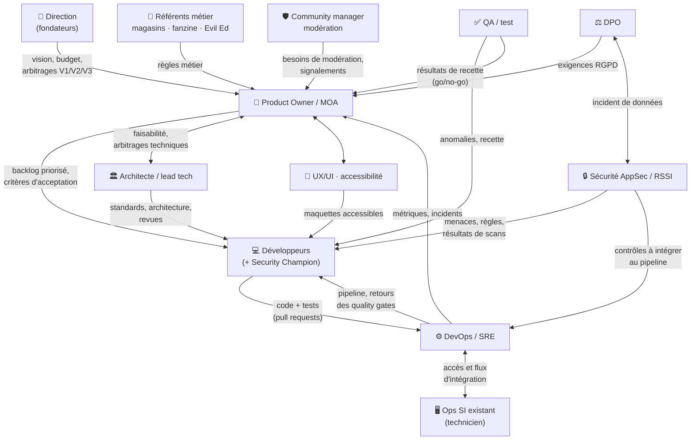

# US-02.3 — Métiers impliqués et leurs interactions

> **Jira :** [SCRUM-19](https://maalsi25.atlassian.net/browse/SCRUM-19) · **Epic :** EPIC 02, Qualité logicielle et démarche DevSecOps
> **Responsable :** Membre D · **Binôme :** Membre B
> **Entrées :** [US-02.2, cycle DevSecOps](US-02.2_cycle_devsecops.md) · [US-01.1, synthèse du besoin](../cadrage/US-01.1_synthese_besoin.md)

**But :** montrer à la direction **qui intervient à chaque étape** du cycle DevSecOps, comment ces métiers collaborent, et **quels recrutements** prévoir au regard de l'équipe actuelle.

---

## 1. Métiers clés

### 1.1 Côté métier (MOA / produit)

| Métier | Définition | Rôle dans le projet |
|---|---|---|
| **Direction (sponsor)** | Porte la vision et finance le projet | Les fondateurs : arbitrent le périmètre V1/V2/V3, le budget et les recrutements |
| **Product Owner (PO) / MOA** | Représente les utilisateurs et le métier. Responsable du **quoi** et du **pourquoi** | Rédige et priorise le backlog, définit les critères d'acceptation, valide les livraisons. Fait le lien avec les magasins, le fanzine, Evil Ed et le festival |
| **Référents métier** | Experts d'un domaine fonctionnel | Responsables de magasin (stock, transferts), rédaction du fanzine (liseuse, abonnements), Evil Ed (exclusivités). Consultés sur les règles métier |
| **Community manager / modérateur** | Anime et modère l'espace communautaire | Exprime les besoins de modération (F-14), traite les signalements. Utilisateur du back-office |

### 1.2 Côté technique (MOE)

| Métier | Définition | Rôle dans le projet |
|---|---|---|
| **Architecte logiciel** | Conçoit la structure globale du système et garantit sa cohérence technique. Responsable du **comment** | Choisit les technologies, découpe en composants, définit les standards, arbitre les tensions entre attributs de qualité (US-02.1). Souvent **lead technique** au quotidien |
| **Développeur·euse** | Conçoit, code et teste les fonctionnalités | Développe le front, le back et les intégrations. Écrit les tests unitaires et d'intégration. Corrige les vulnérabilités détectées. Fait les revues de code entre pairs |
| **Ingénieur·e DevOps / SRE** | Automatise la chaîne de livraison et garantit la fiabilité de la production | Construit et maintient le pipeline CI/CD, l'infrastructure as code, l'orchestrateur, la supervision. Organise l'astreinte et la gestion des incidents |
| **Ingénieur·e sécurité (AppSec) / Security Champion** | S'assure que la sécurité est intégrée à chaque étape | Fait la modélisation des menaces, paramètre les scans (SAST, SCA, DAST), trie les vulnérabilités, forme l'équipe, pilote le test d'intrusion. Le **Security Champion** est un développeur formé qui relaie la sécurité au quotidien |
| **QA / ingénieur·e test** | Garantit que le produit respecte les exigences fonctionnelles et non fonctionnelles | Définit la stratégie de test, automatise les tests de bout en bout, de charge et d'accessibilité, anime la recette avec le PO |
| **UX/UI designer (accessibilité)** | Conçoit des parcours utilisateur ergonomiques et accessibles | Maquettes, design system **conforme RGAA**, tests utilisateurs. Indispensable pour la fluidité (C-02) et l'accessibilité (C-01) |
| **Exploitation / support (Ops)** | Assure le fonctionnement du SI existant et le support de premier niveau | Le **technicien actuel** : gère les accès au SI existant (stock, CRM, caisses), qui sont les points d'intégration, et fait le support aux magasins |

### 1.3 Fonctions transverses (souvent externalisées)

| Fonction | Rôle |
|---|---|
| **DPO (délégué à la protection des données)** | Garantit la conformité RGPD : registre des traitements, consentements pour les recommandations et notifications, durées de conservation |
| **RSSI (responsable de la sécurité du SI)** | Définit la politique de sécurité globale (EPIC 07), y compris pour le SI existant. Peut être mutualisé ou externalisé dans une petite structure |
| **Auditeurs externes** | Test d'intrusion, audit RGAA, audit PCI-DSS avant la mise en production |

---

## 2. Intervention des métiers au fil du cycle DevSecOps

**Légende :** **R** = réalise · **A** = valide (responsable final) · **C** = consulté · **I** = informé

| Étape (US-02.2) | PO / MOA | Architecte | Dév. | DevOps / SRE | Sécurité | QA | UX | Ops | DPO |
|---|---|---|---|---|---|---|---|---|---|
| **1. Planifier** | **A/R** | C | C | C | **R** (menaces) | C | **R** (maquettes) | I | C |
| **2. Coder** | I | **A** (standards) | **R** | C | C | C | C | — | — |
| **3. Build / intégrer** | — | C | **R** | **A** (pipeline) | **R** (SAST/SCA) | I | — | — | — |
| **4. Tester** | C | I | **R** (unit./intég.) | C | **R** (DAST) | **A/R** | **R** (RGAA) | — | — |
| **5. Publier** | **A** (go/no-go) | C | I | **R** | **C** (seuils) | **C** (recette) | — | I | — |
| **6. Déployer** | I | I | I | **A/R** | C | I | — | **I** | — |
| **7. Exploiter** | I | C | C | **A/R** | C | — | — | **R** (SI existant) | — |
| **8. Superviser** | I (indicateurs métier) | C | C | **A/R** | **R** (incidents sécu.) | — | — | **R** (support N1) | **C** (violation de données) |

---

## 3. Schéma des interactions

> Schéma original réalisé par le groupe. Le source Mermaid ci-dessous sert de référence et est redessiné dans le support PPT.

### Interactions clés expliquées

| Interaction | Quand | Contenu |
|---|---|---|
| **PO ↔ Architecte** | Planification, chaque sprint | Le PO exprime le besoin, l'architecte évalue la faisabilité et le coût. Ensemble, ils arbitrent (par exemple : notifications comportementales en V1 ou plus tard ?) |
| **PO → Développeurs** | Sprint planning | Stories priorisées avec critères d'acceptation, clarifiées pendant le sprint |
| **Sécurité → Développeurs** | Planification, revue, après chaque scan | Exigences de sécurité dans les stories, aide à la correction des vulnérabilités, formation. Le Security Champion relaie au quotidien |
| **Sécurité → DevOps** | Mise en place et évolution du pipeline | Définition des scans et des seuils bloquants |
| **Développeurs ↔ DevOps** | En continu | Le pipeline renvoie les erreurs. Les développeurs participent à l'astreinte (« you build it, you run it ») |
| **QA ↔ PO** | Avant chaque release | Recette conjointe et décision **go/no-go** |
| **DevOps → PO** | Après chaque mise en production, puis en continu | Indicateurs techniques et métier qui alimentent la priorisation (boucle d'amélioration continue) |
| **DevOps ↔ Ops (technicien)** | Intégration avec le SI existant | Ouverture des flux (stocks, CRM), accès sécurisés, connaissance de l'existant |
| **Sécurité ↔ DPO** | Incident touchant des données personnelles | Qualification de l'incident, notification à la CNIL sous 72 h si nécessaire |

---

## 4. Dimensionnement de l'équipe

### 4.1 Équipe actuelle (contexte)

| Personne | Métier |
|---|---|
| 1 architecte logiciel (ex-lead dev) | Architecte + lead technique |
| 2 développeur·euse·s juniors en alternance (5 ans d'expérience) | Développeurs, **disponibles à mi-temps environ** (alternance) |
| 1 technicien (existant) | Ops SI existant, support |
| 2 fondateurs ex-IT (ponctuellement) | Appui sur l'existant : infrastructure, réseau |

**Constat :** environ **2 ETP de développement** réellement disponibles. Il n'y a **personne** pour le DevOps, la sécurité, la QA, l'UX ou le rôle de PO, alors que le cycle DevSecOps et les attributs de qualité (sécurité, disponibilité, RGAA) en dépendent directement.

### 4.2 Organisation cible proposée (V1)

| Métier | Solution | Justification |
|---|---|---|
| **Product Owner** | **Interne, à temps partiel** : un fondateur ou un responsable désigné, formé au rôle | Il doit connaître le métier. Sans PO disponible, le backlog n'est pas priorisé |
| **Architecte / lead tech** | Existant | — |
| **Développeurs** | 2 alternants existants + **🆕 1 développeur·euse confirmé·e full-stack** | Sécurise la capacité de livraison et l'encadrement des alternants |
| **DevOps / SRE** | **🆕 Recrutement prioritaire (1 ETP)** | Le pipeline, l'orchestrateur et la supervision sont au cœur de la démarche. Ce rôle ne peut pas être porté par des alternants |
| **Sécurité** | **Security Champion interne** (l'architecte ou le développeur confirmé, formé) + **expertise externe** (test d'intrusion, RSSI à temps partagé) | Une petite structure ne justifie pas un ETP sécurité dédié. L'automatisation du pipeline compense |
| **QA** | **Partagée** : les développeurs écrivent les tests automatisés, le PO fait la recette. Un QA à temps partiel si le budget le permet | Automatisation privilégiée |
| **UX/UI accessibilité** | **Prestation externe** au démarrage (design system RGAA), puis appliqué par les développeurs | Besoin fort au début, plus faible ensuite |
| **Ops SI existant** | Technicien existant | Interlocuteur clé pour les intégrations |
| **DPO** | **Externalisé / mutualisé** | Obligation légale pour un profilage à grande échelle, mais pas un temps plein |
| **Community manager** | Interne (équipe fanzine ou magasins) | Connaît la communauté |

### 4.3 Recrutements recommandés, par priorité

1. 🔴 **Ingénieur·e DevOps / SRE** (avant le démarrage du développement)
2. 🟠 **Développeur·euse confirmé·e full-stack** (dès le premier trimestre), qui devient Security Champion
3. 🟢 **Prestations externes** : UX/accessibilité au démarrage, test d'intrusion et audit RGAA avant la mise en production, DPO mutualisé
4. 🔵 **Pour la V2** (enchères, vidéo) : un second développeur et éventuellement un ingénieur data pour les recommandations

> **Cumul de rôles :** dans une petite équipe, un même individu peut tenir plusieurs rôles (par exemple architecte + Security Champion). Ce qui compte est que **chaque responsabilité du tableau RACI ait un titulaire identifié**.
