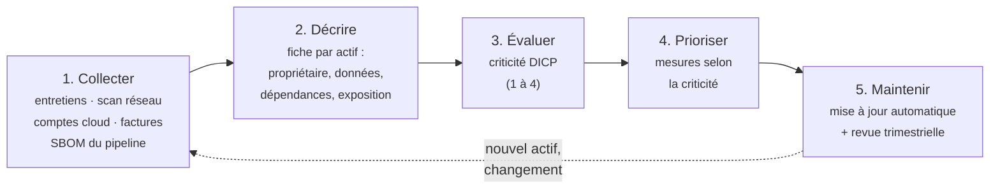

# US-07.1 — Démarche d'inventaire applicatif

> **Jira :** [SCRUM-34](https://maalsi25.atlassian.net/browse/SCRUM-34) · **Epic :** EPIC 07, Politique de sécurité et amélioration continue
> **Responsable :** Membre C · **Binôme :** Membre D
> **Entrées :** [US-01.1, synthèse du besoin](../cadrage/US-01.1_synthese_besoin.md) §1 (état du SI) · [US-03.2, architecture](../architecture/US-03.2_architecture_macroscopique.md)

**But :** savoir **ce qu'il faut protéger**. On ne sécurise pas ce qu'on ne connaît pas : l'inventaire est la **première brique** de la politique de sécurité. Il doit couvrir l'existant, la nouvelle plateforme **et** les applications futures.

---

## 1. Méthode de recensement

### 1.1 Sources de collecte

| Source | Ce qu'elle révèle | Fréquence |
|---|---|---|
| **Entretiens** (technicien, fondateurs, responsables de magasin, Evil Ed) | Applications métier, usages réels, **shadow IT** (outils utilisés sans validation de l'IT) | Initiale, puis annuelle |
| **Découverte réseau** (scan des réseaux des magasins, du siège et du VPN) | Équipements, serveurs, ports ouverts inconnus | Mensuelle |
| **Consoles des fournisseurs cloud et SaaS** | Abonnements, ressources hébergées, comptes administrateurs | Mensuelle |
| **Factures et contrats** | SaaS payants oubliés de l'inventaire | Trimestrielle |
| **Pipeline CI/CD (SBOM)** | Composants logiciels et versions de **chaque** service de la plateforme | **À chaque build**, automatique |
| **Cluster Kubernetes et registre** | Images déployées, versions en production | Continue, automatique |

### 1.2 Fiche d'un actif

| Champ | Exemple (CRM) |
|---|---|
| **Nom, description** | CRM, gestion de la relation client |
| **Propriétaire métier** / **responsable technique** | Direction commerciale / technicien |
| **Hébergement** | SaaS, fournisseur cloud français |
| **Données traitées** | Données personnelles des clients (identité, coordonnées, historique) : **RGPD** |
| **Dépendances / flux** | Export CSV vers les magasins. Demain : connecteur IN-1 |
| **Exposition** | Accessible depuis Internet (interface web) |
| **Authentification** | Comptes nominatifs ? MFA ? *(à vérifier)* |
| **Version / correctifs** | Gérés par l'éditeur |
| **Criticité DICP** | D 3 · I 3 · C 4 · P 3 |
| **Sauvegarde / plan de reprise** | Prévus au contrat ? *(à vérifier)* |

**Échelle DICP :** **D**isponibilité, **I**ntégrité, **C**onfidentialité, **P**reuve (traçabilité). Chaque critère est noté de 1 (faible) à 4 (vital).

---

## 2. Inventaire initial (à partir du contexte)

### 2.1 SI existant

| Actif | Hébergement | Données sensibles | Exposition | D | I | C | P | Points d'attention |
|---|---|---|---|---|---|---|---|---|
| **Site vitrine (CMS)** | Inconnu | Abonnés au fanzine, newsletter | Internet | 2 | 3 | 3 | 2 | CMS = cible fréquente (extensions non à jour). Remplacé par la plateforme |
| **Gestion de stock** | Cloud français | Stocks, prix d'achat | Internet (web) | 3 | 4 | 2 | 3 | Source de vérité pour la vente en ligne : son **intégrité** devient critique |
| **Gestion des fournisseurs** | Cloud français | Contrats, coordonnées bancaires des fournisseurs | Internet (web) | 2 | 3 | 3 | 3 | Risque de fraude au RIB |
| **CRM** | Cloud français | **Données personnelles clients** | Internet (web) | 3 | 3 | 4 | 3 | RGPD |
| **Caisses (×4 magasins)** | Locales | Ventes, éventuellement **paiements carte** | Réseau du magasin | 4 | 4 | 3 | 4 | Périmètre PCI-DSS, systèmes différents par magasin |
| **Échanges CSV** | Messagerie, fichiers | Stocks, clients | Variable | 2 | 3 | 3 | 1 | **Aucune traçabilité**, risque de fuite par email. Remplacés par IN-1 |
| **Serveur de fichiers Ubuntu** (siège Paris) | Local | Documents internes, PAO du fanzine | **VPN** | 3 | 3 | 3 | 2 | **Point de défaillance unique**, géré par une seule personne |
| **Sauvegardes Veeam** | Local | Copie de tout le reste | Réseau interne | 3 | 4 | 4 | 2 | Doivent être **isolées** (immuables, hors ligne) contre les rançongiciels |
| **VPN** | Local | Accès au réseau interne | **Internet** | 3 | 3 | 4 | 3 | Porte d'entrée : MFA et correctifs **prioritaires** |
| **Messagerie Gmail** | SaaS (Google) | Tous les échanges | Internet | 3 | 3 | 4 | 3 | Hameçonnage, MFA, hébergement hors UE |
| **Postes Ubuntu + Mac PAO** | Locaux | Accès à tout le SI | Internet (navigation) | 2 | 2 | 3 | 1 | Correctifs, chiffrement des disques, comptes non administrateurs |
| **Infrastructure Evil Ed** (stations de montage, serveur multimédia redondé) | Local, Paris | Productions non publiées (propriété intellectuelle) | À déterminer | 3 | 3 | 4 | 2 | **Fuite avant sortie** = perte financière (crowdfunding) |
| **Site vitrine Evil Ed** | Inconnu | Faible | Internet | 2 | 3 | 1 | 1 | Défiguration, atteinte à l'image |

### 2.2 Nouvelle plateforme

Les actifs reprennent les composants de [US-03.2](../architecture/US-03.2_architecture_macroscopique.md). Les plus critiques sont :

| Actif | D | I | C | P | Justification |
|---|---|---|---|---|---|
| EN-3 Identité et accès | 4 | 4 | 4 | 4 | Sa compromission ouvre tout le reste |
| SV-2 Commandes / SV-3 Paiement | 4 | 4 | 3 | 4 | Chiffre d'affaires, preuve des transactions |
| SC-1 Bibliothèque et liseuse | 3 | 3 | 3 | 2 | Contenus payants (C-12) |
| SM-2 Messagerie (chat) / SP-2 Recommandation | 2 | 2 | 4 | 3 | Messages privés, **profilage** (RGPD) |
| TR-1 Bus d'événements / TR-4 Secrets | 4 | 4 | 4 | 3 | Composants transverses |
| Pipeline CI/CD, registre d'images | 3 | **4** | 4 | 3 | Une compromission permet d'injecter du code en production |
| Cluster Kubernetes (etcd) | 4 | 4 | 4 | 3 | Contient l'état et les secrets du cluster |

---

## 3. Maintenir l'inventaire à jour, y compris pour les applications futures

| Mécanisme | Effet |
|---|---|
| **Règle « pas de fiche, pas de production »** | Toute nouvelle application (V2 enchères, V2 vidéo, V3 billetterie, nouveau SaaS) doit avoir sa fiche **avant** sa mise en service. Ce point est intégré à la *Definition of Done* et à l'étape « Planifier » du cycle DevSecOps |
| **Inventaire automatique de la plateforme** | Le SBOM produit à chaque build et la liste des images déployées alimentent l'inventaire **sans saisie manuelle** |
| **Étiquetage obligatoire** des ressources cloud et Kubernetes (propriétaire, criticité, données) | Une ressource sans étiquette est signalée par un contrôle automatique |
| **Revue trimestrielle** par le RSSI (externe) et le technicien | Retrait des actifs décommissionnés, détection du shadow IT |
| **Lien avec les contrats** | Toute nouvelle souscription SaaS passe par une validation sécurité légère (hébergement UE, MFA, réversibilité) |

**Outil :** au démarrage, un **tableur partagé** ou un **projet Jira dédié** suffit. Le format compte moins que la **discipline de mise à jour**. Un outil de CMDB pourra venir plus tard.

---

## 4. Priorités qui découlent de l'inventaire

1. 🔴 **VPN, messagerie, consoles cloud :** MFA pour tous les comptes, sans exception.
2. 🔴 **Sauvegardes :** une copie **immuable** ou hors ligne, avec un test de restauration.
3. 🔴 **Caisses :** vérifier le périmètre PCI-DSS avec chaque fournisseur de caisse.
4. 🟠 **Serveur de fichiers :** supprimer le point de défaillance unique (réplication, ou migration vers un stockage managé en UE).
5. 🟠 **Échanges CSV :** les remplacer par le connecteur IN-1 (flux authentifiés et tracés).
6. 🟢 **Shadow IT :** recensement lors des entretiens, puis validation ou retrait.
