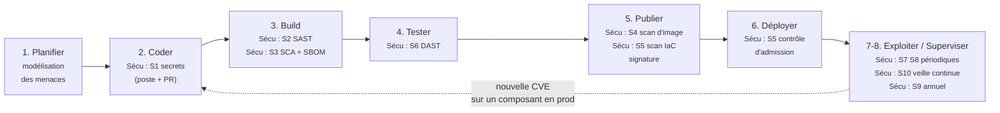
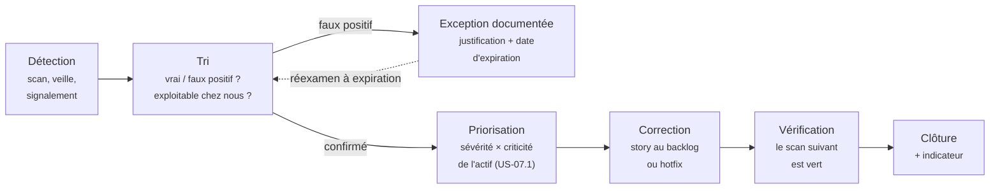

# US-07.2 — Contrôles et scans de sécurité

> **Jira :** [SCRUM-35](https://maalsi25.atlassian.net/browse/SCRUM-35) · **Epic :** EPIC 07, Politique de sécurité et amélioration continue
> **Responsable :** Membre C · **Binôme :** Membre D
> **Entrées :** [US-02.2, cycle DevSecOps](../qualite_devsecops/US-02.2_cycle_devsecops.md) · [US-04.4, CI/CD](../cicd/US-04.4_conclusion_comparative.md) · [US-07.1, inventaire](US-07.1_inventaire_applicatif.md)

**But :** détecter les vulnérabilités **le plus tôt possible**, sur la plateforme **et** sur le SI existant, puis **traiter** chaque constat dans un délai maîtrisé.

---

## 1. Catégories de contrôles

| # | Catégorie | Ce qui est analysé | Exemples de problèmes trouvés | Périmètre |
|---|---|---|---|---|
| **S1** | **Détection de secrets** | Code et historique Git | Mot de passe, clé d'API, jeton commité par erreur | Plateforme |
| **S2** | **SAST** (analyse statique) | Code source | Injection SQL, XSS, désérialisation dangereuse | Plateforme |
| **S3** | **SCA** + **SBOM** | Dépendances open source | Bibliothèque avec une CVE connue, licence incompatible | Plateforme |
| **S4** | **Scan d'image** | Image de conteneur (OS + bibliothèques) | Paquet système vulnérable, exécution en root | Plateforme |
| **S5** | **Scan IaC / configuration** | Manifestes Kubernetes, configuration cloud | Conteneur privilégié, port ouvert, stockage public | Plateforme |
| **S6** | **DAST** (analyse dynamique) | Application déployée en intégration | En-têtes manquants, injection, session mal protégée | Plateforme |
| **S7** | **Scan de vulnérabilités infrastructure** | Serveurs, VPN, postes, équipements réseau | Système non à jour, service exposé inutilement | **SI existant** + nœuds |
| **S8** | **Revue de configuration cloud et SaaS** | Comptes des fournisseurs (stock, CRM, Gmail, hébergeur) | Compte administrateur sans MFA, partage public | **SI existant** |
| **S9** | **Test d'intrusion** | Plateforme complète, VPN | Enchaînement de failles exploitables | Les deux |
| **S10** | **Veille vulnérabilités** | Bulletins (CERT-FR, éditeurs) croisés avec le SBOM | Nouvelle CVE sur un composant **déjà en production** | Les deux |

---

## 2. Place dans le cycle DevSecOps

| Contrôle | Étape | Fréquence | Bloquant ? |
|---|---|---|---|
| S1 Secrets | Coder (pré-commit) + PR | Chaque commit | Oui |
| S2 SAST | Build (PR) | Chaque PR | Sévérité haute et plus |
| S3 SCA + SBOM | Build (PR) | Chaque PR **et** chaque nuit sur `main` | Critique ou haute corrigeable |
| S4 Scan d'image | Publier | Chaque image **et** chaque nuit sur les images en production | Critique corrigeable |
| S5 Scan IaC | Publier + **contrôle d'admission** au déploiement | Chaque modification | Conteneur root ou privilégié refusé par le cluster |
| S6 DAST | Tester (intégration) | Chaque image candidate | Sévérité haute |
| S7 Infrastructure | Exploiter | **Mensuelle** + après tout changement majeur | Traitement selon le SLA |
| S8 Configuration cloud et SaaS | Exploiter | **Trimestrielle** | Traitement selon le SLA |
| S9 Test d'intrusion | Avant la mise en production, puis **annuel** | Annuelle | Bloque la 1re mise en production |
| S10 Veille | Superviser | **Continue** | Déclenche un correctif |

**Démontré :** S1, S2, S3, S4 tournent dans les deux pipelines de l'EPIC 04 (gitleaks, bandit, pip-audit, trivy). Le scénario `secret` montre le blocage d'une livraison. Les règles de S5 (non-root, `drop: ALL`, système de fichiers en lecture seule) sont appliquées dans les manifestes de la démo Kubernetes.

---

## 3. Traitement des constats

### Délais de correction (SLA)

| Sévérité (après tri) | Actif exposé sur Internet ou critique (DICP 4) | Autre actif |
|---|---|---|
| [Élevé] **Critique** | **48 h** (hotfix, même pipeline, aucun raccourci) | 7 jours |
| [Moyen] **Haute** | **7 jours** | 30 jours |
| [Modéré] **Moyenne** | 30 jours | 90 jours |
| [Faible] **Faible** | Au fil des sprints | Au fil des sprints |

**Règles :**
- **Le tri** est fait par le **Security Champion** (cf. [US-02.3](../qualite_devsecops/US-02.3_metiers_interactions.md)). En cas de doute, il sollicite le RSSI externe.
- **Une exception** (faux positif, absence de correctif) est **écrite**, validée, et a une **date d'expiration**. Il n'y a jamais d'exception permanente.
- **Une vulnérabilité en production sans correctif** est traitée par une **mesure compensatoire** : règle du WAF (EN-1), désactivation de la fonction, isolement réseau.
- **Chaque constat est tracé** (ticket Jira avec le label `securite`), pour mesurer les délais et alimenter l'amélioration continue ([US-07.4](US-07.4_amelioration_continue.md)).

### Mise en œuvre réelle sur la boutique de démonstration

Les contrôles ci-dessus tournent dans le pipeline de la [boutique](../../demos/boutique/README.md) (GitHub Actions et Jenkins). Au premier passage, le **scan des images a bloqué la livraison**. Chaque constat a été traité selon les règles de cette page :

| Constat (Trivy, sévérité critique, correctif disponible) | Traitement | Type |
|---|---|---|
| Spring Boot 3.4 : failles de Tomcat, Spring Framework et Spring Security (jusqu'à 15 par image) | **Correction** : migration vers Spring Boot 4.0.10. Ces correctifs n'existaient que dans Spring Framework 7 | Mise à jour de dépendances |
| Image NGINX du front : faille de la bibliothèque brotli | **Correction** : mise à jour des paquets de l'image de base au moment du build (`apk upgrade`) | Durcissement de l'image de base |
| Image PostgreSQL : bibliothèque TLS de Go embarquée dans `gosu` | **Exception documentée** dans [`.trivyignore.yaml`](../../demos/boutique/.trivyignore.yaml) : `gosu` n'ouvre aucune connexion TLS, l'image ne sert qu'en développement (base managée en production). **Expiration au 28/02/2027** | Exception justifiée et datée |

Résultat : 9 images sur 9 sans vulnérabilité critique corrigeable, **hors une exception écrite, justifiée et qui expire**. Passé la date, le pipeline redevient rouge et la décision est réexaminée.
