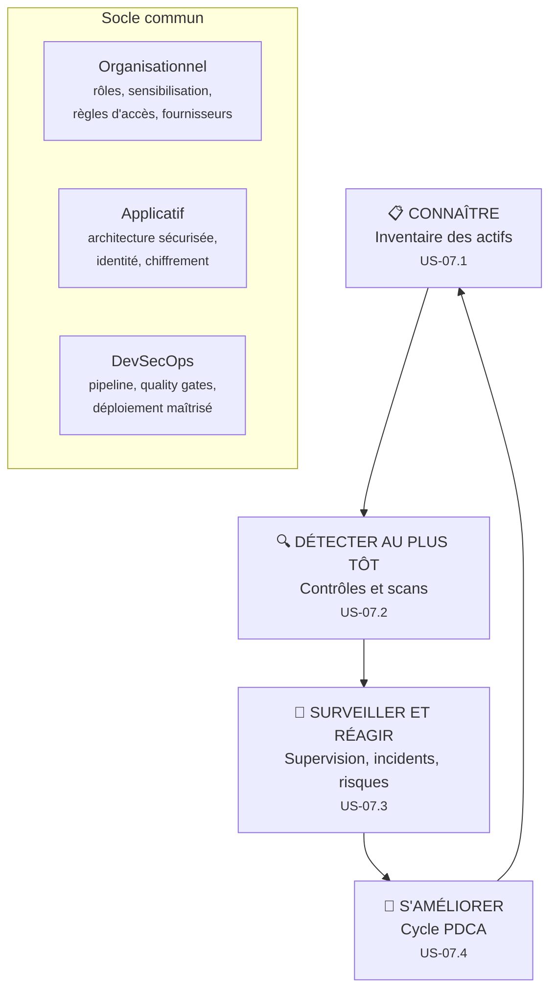
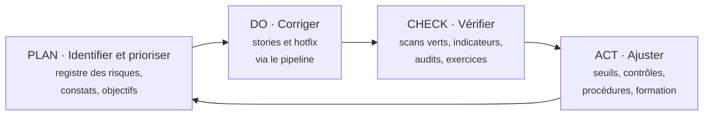

# US-07.4 — Amélioration continue de la sécurité

> **Jira :** [SCRUM-37](https://maalsi25.atlassian.net/browse/SCRUM-37) · **Epic :** EPIC 07, Politique de sécurité et amélioration continue
> **Responsable :** Membre C · **Binôme :** Membre D
> **Entrées :** [US-07.1, inventaire](US-07.1_inventaire_applicatif.md) · [US-07.2, contrôles et scans](US-07.2_controles_scans.md) · [US-07.3, supervision et incidents](US-07.3_supervision_incidents.md)

**But :** faire en sorte que **chaque événement** (incident, scan, audit, retour d'expérience) **renforce durablement** la sécurité, au lieu d'être traité une seule fois puis oublié.

---

## 1. Vue d'ensemble de la politique de sécurité

La politique de sécurité de la Petite Maison de l'Épouvante s'articule en **4 briques**, reliées par une boucle d'amélioration continue :

---

## 2. Le cycle d'amélioration continue (PDCA)

| Phase | Ce qu'on fait | Qui | Sortie |
|---|---|---|---|
| **Plan : identifier et prioriser** | Rassembler les entrées (§3). Mettre à jour le registre des risques. Prioriser selon **gravité × vraisemblance** et la criticité de l'actif | RSSI externe + Security Champion + PO | Actions de sécurité **dans le backlog**, au même titre que les fonctionnalités |
| **Do : corriger** | Corriger dans les délais du SLA (US-07.2), **toujours via le pipeline** | Développeurs, DevOps, technicien | Correctifs déployés |
| **Check : vérifier** | Le scan suivant est vert. Le risque a baissé. L'exercice est réussi | Security Champion, QA | Indicateurs (§4) |
| **Act : ajuster** | **Ajouter un contrôle** pour que le problème ne revienne pas : nouvelle règle SAST, nouveau test, nouvelle alerte, procédure revue | Security Champion + DevOps | Pipeline et procédures enrichis |

**Règle clé :** chaque incident ou constat significatif doit produire **au moins une mesure préventive automatisée**. Par exemple, après une fuite de secret : détection de secrets avant le commit sur tous les postes **et** rotation automatique du secret.

---

## 3. Les entrées de la boucle

| Entrée | Fréquence | Exemple d'amélioration produite |
|---|---|---|
| **Post-mortem d'incident** (US-07.3) | Après chaque P1/P2 | Nouvelle alerte, runbook corrigé, test de résilience ajouté |
| **Résultats des scans** (US-07.2) | Continue | Dépendance remplacée, règle d'image de base durcie |
| **Test d'intrusion / audit** | Annuel | Nouveaux tests DAST couvrant les failles trouvées |
| **Veille vulnérabilités** (CERT-FR, éditeurs) | Continue | Correctif prioritaire, mesure compensatoire au WAF |
| **Revue de l'inventaire** (US-07.1) | Trimestrielle | Retrait d'un SaaS inutilisé, MFA activée sur un compte oublié |
| **Exercices** (restauration, simulation de crise, campagne d'hameçonnage) | Semestrielle | Sauvegarde corrigée, formation ciblée |
| **Évolutions du SI** (V2 enchères et vidéo, V3 billetterie) | À chaque évolution | Nouvelle analyse de risques **avant** le développement |
| **Rétrospectives d'équipe** | Chaque sprint | Seuils de quality gate ajustés, faux positifs éliminés |

---

## 4. Indicateurs de pilotage

| Indicateur | Cible | Brique |
|---|---|---|
| Actifs inventoriés avec propriétaire et criticité | **100 %** | Connaître |
| Comptes administrateurs avec MFA (plateforme **et** SI existant) | **100 %** | Socle |
| Vulnérabilités critiques ou hautes ouvertes au-delà du SLA | **0** | Détecter |
| Délai moyen de correction d'une vulnérabilité critique | < **48 h** | Détecter |
| Temps moyen de détection d'un incident (MTTD) | < **15 min** | Réagir |
| Temps moyen de rétablissement (MTTR) | < **1 h** (indicateur DORA, US-02.2) | Réagir |
| Restaurations de sauvegarde réussies | **100 %** (mensuelle) | Réagir |
| Post-mortems avec au moins une action préventive | **100 %** | S'améliorer |
| Personnel sensibilisé (formation annuelle) | **100 %** | Socle |

Les indicateurs sont présentés à la **direction chaque trimestre** : c'est elle qui arbitre les risques résiduels.

---

## 5. Continuité entre sécurité organisationnelle, applicative et DevSecOps

| Exemple de risque | Mesure organisationnelle | Mesure applicative | Mesure DevSecOps |
|---|---|---|---|
| **Vol d'identifiants** | Sensibilisation à l'hameçonnage, départs gérés (révocation le jour même) | MFA (EN-3), détection des connexions anormales | Secrets jamais dans le code (S1), rotation automatique |
| **Dépendance vulnérable** | Veille assignée au Security Champion | Isolation des services (un composant compromis ne donne pas accès aux autres) | SCA bloquant, SBOM, scan nocturne des images en production |
| **Rançongiciel** | Plan de reprise documenté, exercice annuel | Données de la plateforme en service managé UE, sauvegardées | Infrastructure as code : la plateforme est **reconstructible** à partir du dépôt |
| **Nouvelle fonctionnalité (V2 enchères)** | Analyse de risques en atelier avec le PO | Contrôles anti-fraude, limitation de débit | Nouveaux tests de charge et DAST dans le pipeline |

---

## 6. Calendrier de la première année

| Période | Actions |
|---|---|
| **Mois 1** | Inventaire initial, MFA partout, sauvegarde immuable, nomination du Security Champion, atelier de risques |
| **Mois 2-3** | Pipeline avec contrôles S1 à S6, centralisation des journaux, runbooks P1 |
| **Avant la mise en production** | Test d'intrusion, audit RGAA, audit PCI-DSS (périmètre réduit grâce au prestataire de paiement), exercice de crise |
| **Ensuite, chaque mois** | Scan d'infrastructure (S7), test de restauration, revue des indicateurs |
| **Chaque trimestre** | Revue de l'inventaire et des risques, revue SaaS (S8), comité avec la direction |
| **Chaque année** | Test d'intrusion, formation, mise à jour de la politique. Trajectoire possible vers **ISO 27001** si un partenaire ou un client l'exige |
