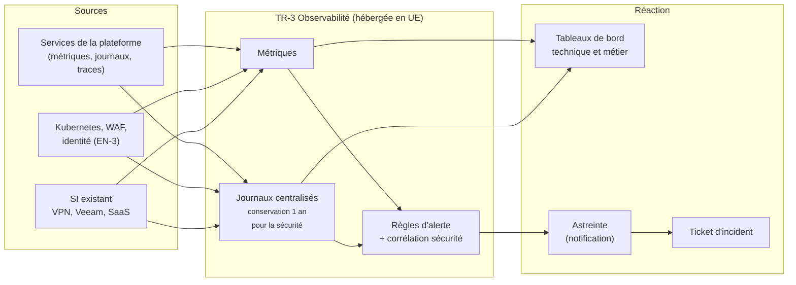
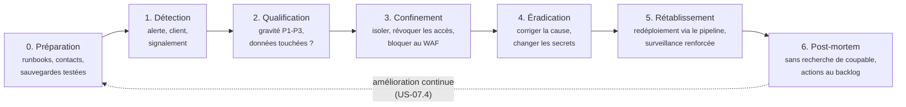

# Supervision et réaction aux incidents

> **Story :** US-07.3 · **Jira :** [SCRUM-36](https://maalsi25.atlassian.net/browse/SCRUM-36) · **Epic :** EPIC 07, Politique de sécurité et amélioration continue
> **Responsable :** Membre B *(renfort)* · **Binôme :** Membre C
> **Entrées :** [US-07.1, inventaire](inventaire-du-parc.md) · [US-02.2, cycle DevSecOps](../qualite-devsecops/cycle-devsecops.md) (étape 8) · [US-02.3, métiers](../qualite-devsecops/metiers-et-interactions.md)

**But :** **détecter** rapidement les anomalies (techniques et de sécurité), **réagir** de façon organisée, et **gérer les risques** avant qu'ils ne deviennent des incidents.

---

## 1. Principes de supervision

### 1.1 Ce qu'on observe

| Niveau | Signaux | Exemples d'alertes |
|---|---|---|
| **Infrastructure** | CPU, mémoire, disque, état des nœuds et des pods, certificats | Nœud indisponible, disque plein à 85 %, certificat expirant sous 15 jours |
| **Applicatif** | Taux d'erreur, latence (p95), débit, files du bus d'événements (retard, DLQ) | Taux d'erreur > 2 %, p95 > 300 ms pendant 5 min, DLQ non vide |
| **Métier** | Commandes par heure, échecs de paiement, inscriptions, signalements de modération | Chute de 50 % des commandes par rapport à l'heure équivalente, pic d'échecs de paiement |
| **Sécurité** | Journaux d'authentification, du WAF, de l'API Kubernetes, des accès administrateur, du VPN | Rafale d'échecs de connexion (*credential stuffing*), connexion administrateur depuis un pays inhabituel, modification de droits |
| **SI existant** | Disponibilité des applications SaaS, VPN, sauvegardes Veeam, connecteur IN-1 | Sauvegarde en échec, synchronisation des stocks en retard de plus de 5 min |

### 1.2 Architecture de supervision

**Règles :**
- **Journaux centralisés et protégés :** un attaquant ne doit pas pouvoir effacer ses traces. Les données personnelles sont **masquées** dans les journaux (RGPD).
- **Peu d'alertes, mais actionnables :** chaque alerte a un **propriétaire** et une **procédure** (*runbook*). Une alerte ignorée trois fois est corrigée ou supprimée.
- **Supervision synthétique :** un robot rejoue le parcours d'achat toutes les 5 minutes depuis l'extérieur, ce qui détecte une panne avant les clients.

---

## 2. Gestion des incidents

### 2.1 Niveaux de gravité

| Niveau | Définition | Exemples | Délai de prise en charge |
|---|---|---|---|
| **P1 critique** | Vente impossible, **fuite de données**, compromission avérée | Site indisponible, paiement en panne, base de clients exfiltrée, rançongiciel | **15 min**, 24 h/24 |
| **P2 majeur** | Fonction importante dégradée, suspicion de compromission | Chat ou liseuse indisponible, compte administrateur suspect | 1 h (heures ouvrées étendues) |
| **P3 mineur** | Impact limité, contournement possible | Recommandations absentes, lenteur ponctuelle | Jour ouvré suivant |

### 2.2 Processus de réponse

Le processus s'inspire du cycle de gestion d'incidents de sécurité du **NIST SP 800-61**.

### 2.3 Responsabilités : alerte, escalade, correction

| Rôle | Responsabilité pendant un incident | Titulaire (cf. US-02.3) |
|---|---|---|
| **Astreinte (1er niveau)** | Reçoit l'alerte, qualifie, applique le runbook, **escalade** si nécessaire | DevOps / SRE, en rotation avec l'architecte et le développeur confirmé |
| **Responsable d'incident** | Coordonne (P1/P2), décide du confinement, tient la chronologie | DevOps / SRE, ou l'architecte |
| **Équipe de correction** | Corrige et redéploie **via le pipeline** (aucun correctif manuel en production) | Développeurs concernés |
| **Security Champion / RSSI externe** | Analyse un incident de sécurité, conserve les preuves | Dév. confirmé + RSSI externe |
| **DPO** | Évalue la violation de données. **Notifie la CNIL sous 72 h** si nécessaire, et les personnes concernées si le risque est élevé | DPO mutualisé |
| **Direction** | Décide pour les P1 (communication, fermeture temporaire, dépôt de plainte) | Fondateurs |
| **Communication** | Informe les clients, les magasins et Evil Ed | PO / community manager |
| **Technicien SI existant** | Intervient sur le VPN, les caisses, le serveur de fichiers, Veeam | Technicien |

**Chaîne d'escalade :** astreinte → (15 min sans résolution ou P1) → responsable d'incident → (P1 sécurité) RSSI + DPO + direction.

**Adaptation à une petite équipe :** l'astreinte tourne entre **3 personnes** (DevOps, architecte, développeur confirmé). Les alternants n'en font pas partie. L'astreinte 24/7 est limitée au **P1**, et un **contrat de réponse à incident** avec un prestataire externe couvre les incidents de sécurité majeurs.

---

## 3. Gestion des risques

### 3.1 Méthode

Démarche **allégée**, inspirée d'**EBIOS Risk Manager** (ANSSI) : 1 atelier initial, puis une mise à jour à chaque trimestre et à chaque évolution majeure (V2, V3).

1. **Partir de l'inventaire** (US-07.1) : actifs et criticité DICP.
2. **Identifier les sources de risque** : cybercriminels (rançongiciel, fraude à la carte), concurrents, utilisateurs malveillants de la communauté, erreur interne, fournisseur défaillant.
3. **Construire des scénarios** et les noter en **gravité × vraisemblance** (de 1 à 4).
4. **Décider** pour chaque risque : **réduire**, **transférer** (assurance cyber, prestataire de paiement), **éviter** ou **accepter**, avec une décision formelle de la direction.

### 3.2 Registre des risques principaux (initial)

| # | Scénario | G | V | Niveau | Traitement |
|---|---|---|---|---|---|
| R1 | **Rançongiciel** via le VPN ou un poste, qui chiffre le serveur de fichiers **et** les sauvegardes | 4 | 3 | 12 élevé | MFA sur le VPN, sauvegarde **immuable** hors ligne, correctifs mensuels, EDR sur les postes |
| R2 | **Vol de données clients** (injection, compte administrateur compromis) | 4 | 2 | 8 élevé | SAST/DAST, MFA administrateur, cloisonnement, chiffrement, journaux protégés |
| R3 | **Fraude au paiement** / vol de cartes | 4 | 2 | 8 élevé | **Transféré** au prestataire de paiement (aucune carte stockée, 3-D Secure) |
| R4 | **Indisponibilité pendant un pic** (festival, exclusivité) | 3 | 3 | 9 moyen | Tests de charge avant chaque pic, mise à l'échelle automatique, gel des déploiements |
| R5 | **Compromission de la chaîne CI/CD** (action tierce, dépendance piégée) | 4 | 2 | 8 élevé | Actions figées par SHA, SCA, SBOM, signature des images |
| R6 | **Contenus illicites** ou arnaques dans le troc et le chat | 3 | 3 | 9 moyen | Modération (SM-3), signalement, traitement des retraits |
| R7 | **Fuite d'une production Evil Ed** avant sa sortie | 3 | 2 | 6 moyen | Cloisonnement de l'infrastructure média, droits nominatifs, journalisation |
| R8 | **Dépendance à une seule personne** (le technicien) | 3 | 3 | 9 moyen | Documentation, comptes nominatifs, double compétence avec le DevOps |

> **Règle de couleur :** Niveau **élevé** dès que la **gravité vaut 4** (impact vital : vente, données clients, intégrité de la chaîne de livraison), quelle que soit la vraisemblance. niveau **moyen** pour les autres risques de niveau ≥ 6. Les risques **élevés** sont traités en priorité et suivis par la direction chaque trimestre.

---

[← Contrôles et scans de sécurité](controles-et-scans.md) · [Sommaire](../README.md) · [Amélioration continue de la sécurité →](amelioration-continue.md)
