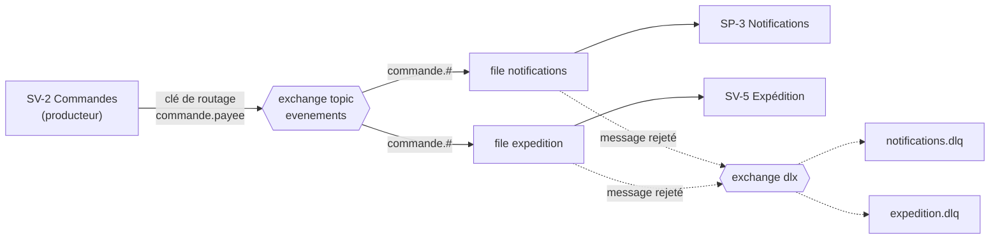

# US-05.2 — Démonstration de la première technologie : RabbitMQ

> **Jira :** [SCRUM-28](https://maalsi25.atlassian.net/browse/SCRUM-28) · **Epic :** EPIC 05, Comparaison et démonstration de deux technologies applicatives
> **Responsable :** Membre C · **Binôme :** Membre B
> **Scénario de référence :** [US-05.1](US-05.1_domaine_et_criteres.md) §4 · **Code :** [`demos/messaging/`](../../demos/messaging/) · **Implémentation :** [`bus/bus_rabbitmq.py`](../../demos/messaging/bus/bus_rabbitmq.py)

---

## 1. Cas d'usage démontré

Le composant **TR-1 Bus d'événements** de l'architecture, sur le flux **« commande payée »** : le service Commandes publie, les services Notifications et Expédition consomment. La démo est **minimale et représentative** : elle ne nécessite pas l'e-commerce.

## 2. Topologie mise en place

| Concept RabbitMQ | Rôle dans la démo |
|---|---|
| **Exchange `topic`** | Reçoit les événements et les **route** selon leur clé (`commande.payee`). Un futur `annonce.publiee` pourra être routé vers d'autres files sans toucher au producteur |
| **File (queue) par service** | Chaque service a **sa** file. Un même événement est donc **copié** pour chaque abonné |
| **Durabilité** | Files `durable` + messages `persistent` : ils survivent à un redémarrage du broker |
| **Acquittement (`ack`)** | Le message n'est retiré de la file **qu'après** traitement réussi. S'il n'y a pas d'acquittement (panne du consommateur), il est redistribué |
| **Dead letter exchange** | Déclaré par **un simple argument de file**. Un message rejeté (`nack`) est automatiquement déplacé vers la DLQ du service |
| **Confirmation d'écriture** | Transaction AMQP par lot de 500 messages : le broker confirme que les messages sont écrits sur disque |

## 3. Déroulé de la démonstration (environ 3 min)

| # | Action | Ce que la direction voit |
|---|---|---|
| 1 | `docker compose up -d --wait rabbitmq` (lancé avant la soutenance) | Un seul conteneur, prêt en ~7 s |
| 2 | Ouvrir la console http://localhost:15672 | Interface d'administration intégrée au broker |
| 3 | `python scenario.py rabbitmq --pause` | Étape par étape, les ✅ s'affichent |
| 4 | Pendant l'étape 2, montrer l'onglet *Queues* | La file `expedition` **accumule** 5 messages pendant la « panne », puis se vide au redémarrage |
| 5 | Étape 3 | Le nouveau service ne reçoit **rien** du passé : ce qui a été consommé est supprimé |
| 6 | Étape 4, onglet *Queues* | La file `notifications.dlq` contient le message invalide, disponible pour analyse |

## 4. Résultats observés

**Scénario** (exécuté sur poste Windows 11, Docker Desktop, le 14/11/2026) :

| Étape | Résultat | Attendu | Statut |
|---|---|---|---|
| 1. Diffusion (notifications / expédition) | 5 / 5 | 5 / 5 | ✅ |
| 2. Panne : notifications en ligne / expédition rattrapée | 5 / 5 | 5 / 5 | ✅ |
| 3. Rejeu de l'historique par un nouveau service | 0 | 0 | ✅ (limite du modèle) |
| 4. Poison : traité / isolé en DLQ | 0 / 1 | 0 / 1 | ✅ |
| **Bilan** | **7 / 7 vérifications**, 15,6 s | | ✅ |

**Banc de mesure** (20 000 messages de 186 octets, client dans le réseau Docker, 3 passes) :

| Mode | Publication | Consommation |
|---|---|---|
| Confirmation par lot de 500 | **11 000 à 11 700 msg/s** | **15 200 à 18 700 msg/s** |
| Sans confirmation | 21 400 msg/s | 18 200 msg/s |
| Confirmation **unitaire** (le client attend chaque message) | **263 msg/s** | 16 000 msg/s |

**Empreinte :** **169 Mio** de mémoire au repos (console incluse), image de **392 Mo**, démarrage à froid en **~7 s**.

## 5. Prérequis et limites rencontrés

| Constat | Détail |
|---|---|
| ✅ **Mise en place rapide** | 2 variables d'environnement (utilisateur, mot de passe). La console d'administration est livrée avec le broker |
| ✅ **DLQ native** | Un argument de file suffit (`x-dead-letter-exchange`). Aucun code applicatif |
| ✅ **Routage expressif** | Les clés à motifs (`commande.#`) permettent d'ajouter des types d'événements sans modifier les producteurs |
| ⚠️ **Confirmation unitaire très lente** | 263 msg/s : chaque message attend son écriture disque. Il faut **confirmer par lot** ou utiliser des confirmations asynchrones. C'est un **piège** à connaître pour les développeurs juniors |
| ⚠️ **Piège de mesure rencontré** | Depuis l'hôte Windows, la confirmation unitaire tombait à **19 msg/s**, à cause du proxy de ports de Docker Desktop (environ 50 ms par aller-retour). D'où les mesures faites dans le réseau Docker |
| ⚠️ **Mode transactionnel** | Il retient aussi les acquittements jusqu'au commit : il faut un **canal séparé** pour lire (bug rencontré et corrigé pendant la démo) |
| ⛔ **Pas de rejeu** | Un message acquitté est supprimé. Un nouveau service ne voit que les messages **futurs**. *Atténuation possible :* les **RabbitMQ Streams** (depuis la version 3.9) offrent un journal relisible, au prix d'un second modèle à maîtriser |
| ⛔ **Bibliothèque `pika` synchrone** | Simple à apprendre, mais pas de confirmations asynchrones en mode bloquant. En production, préférer un client asynchrone |
