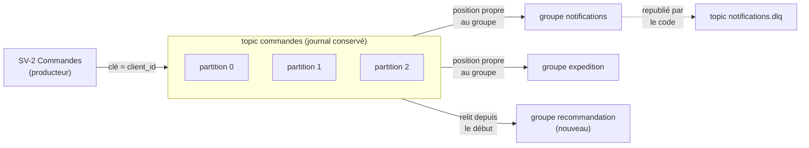

# US-05.3 — Démonstration de la seconde technologie : Apache Kafka

> **Jira :** [SCRUM-29](https://maalsi25.atlassian.net/browse/SCRUM-29) · **Epic :** EPIC 05, Comparaison et démonstration de deux technologies applicatives
> **Responsable :** Membre A *(renfort)* · **Binôme :** Membre C
> **Scénario de référence :** [US-05.1](US-05.1_domaine_et_criteres.md) §4 · **Code :** [`demos/messaging/`](../../demos/messaging/) · **Implémentation :** [`bus/bus_kafka.py`](../../demos/messaging/bus/bus_kafka.py)

---

## 1. Cas d'usage démontré

**Strictement le même** que pour RabbitMQ ([US-05.2](US-05.2_demo_rabbitmq.md)) : l'événement « commande payée », publié par Commandes et consommé par Notifications et Expédition. Le fichier `scenario.py` est **commun** : seule l'implémentation du bus change.

## 2. Topologie mise en place

| Concept Kafka | Rôle dans la démo |
|---|---|
| **Topic** | Journal **en ajout seul** : les événements y restent pendant la durée de rétention (7 jours par défaut), qu'ils aient été lus ou non |
| **Partitions (3)** | Unité de parallélisme. La **clé** (`client_id`) garantit que les événements d'un même client restent **dans l'ordre** |
| **Groupe de consommateurs** | Un groupe par service. Chaque groupe mémorise **sa position** (*offset*) dans le journal |
| **Commit de position** | Le service enregistre sa position après traitement. En cas de panne, il reprend là où il s'était arrêté |
| **`acks=all` + idempotence** | L'écriture est confirmée et un nouvel essai ne crée pas de doublon |
| **Mode KRaft** | Kafka gère lui-même ses métadonnées (sans ZooKeeper depuis la version 3.3) |
| **DLQ** | **N'existe pas côté consommateur** : c'est **notre code** qui republie le message invalide dans un topic dédié |

## 3. Déroulé de la démonstration (environ 3 min)

| # | Action | Ce que la direction voit |
|---|---|---|
| 1 | `docker compose up -d --wait kafka kafka-ui` (lancé avant la soutenance) | Broker + console séparée |
| 2 | Ouvrir kafka-ui http://localhost:8081 | Topics, partitions, messages, groupes et leurs positions |
| 3 | `python scenario.py kafka --pause` | Les mêmes étapes, les mêmes ✅ |
| 4 | Étape 2, onglet *Consumers* | Le groupe `expedition` a un **retard** (*lag*) de 5, qui retombe à 0 au redémarrage |
| 5 | Étape 3 | Le nouveau groupe `recommandation` **relit les 10 commandes passées** : c'est la différence clé avec RabbitMQ |
| 6 | Onglet *Topics → Messages* | Les messages sont **toujours là** après lecture |

## 4. Résultats observés

**Scénario** (même poste, même jour que US-05.2) :

| Étape | Résultat | Attendu | Statut |
|---|---|---|---|
| 1. Diffusion (notifications / expédition) | 5 / 5 | 5 / 5 | ✅ |
| 2. Panne : notifications en ligne / expédition rattrapée | 5 / 5 | 5 / 5 | ✅ |
| 3. Rejeu de l'historique par un nouveau service | **10** | 10 | ✅ (force du modèle) |
| 4. Poison : traité / isolé en DLQ | 0 / 1 | 0 / 1 | ✅ (DLQ codée) |
| **Bilan** | **7 / 7 vérifications**, 17,3 s | | ✅ |

**Banc de mesure** (mêmes conditions que RabbitMQ) :

| Mode | Publication | Consommation |
|---|---|---|
| `acks=all`, envoi par lots | **21 900 à 22 500 msg/s** | **216 000 à 270 000 msg/s** |

**Empreinte :** **995 Mio** de mémoire au repos pour le broker seul (+ 386 Mio pour la console kafka-ui), image de **599 Mo**, démarrage à froid en **~8 s**.

## 5. Prérequis et limites rencontrés

| Constat | Détail |
|---|---|
| ✅ **Rejeu natif** | N'importe quel nouveau service peut relire l'historique, sans rien demander au producteur |
| ✅ **Débit très élevé** | Publication environ **2 fois** plus rapide, consommation environ **14 fois** plus rapide que RabbitMQ (lecture séquentielle par lots) |
| ✅ **Ordre garanti par clé** | Tous les événements d'un même client arrivent dans l'ordre : utile pour les enchères de la V2 |
| ⚠️ **Configuration plus lourde** | **13 variables** de configuration pour un seul nœud (écoutes réseau, contrôleur KRaft, facteurs de réplication) contre 2 pour RabbitMQ |
| ⚠️ **Concepts plus nombreux** | Partitions, groupes, positions, rééquilibrage, rétention : courbe d'apprentissage plus raide pour des alternants |
| ⚠️ **Rééquilibrage** | À la première lecture, un groupe attend l'attribution de ses partitions (quelques secondes). Le code doit le gérer (cas rencontré pendant la démo) |
| ⚠️ **Commit de position** | Un commit message par message limitait la consommation à **4 000 msg/s**. Il faut le faire **par lot** (problème rencontré et corrigé) |
| ⛔ **Pas de DLQ native** | Le rebut, les nouvelles tentatives et le routage fin sont **à coder** dans chaque service (ou à confier à Kafka Connect / Kafka Streams) |
| ⛔ **Empreinte mémoire** | **6 fois** celle de RabbitMQ au repos. En production, **3 nœuds minimum** sont recommandés pour la tolérance aux pannes |
| ⛔ **Pas de console intégrée** | La console est un produit tiers à déployer et à sécuriser |
